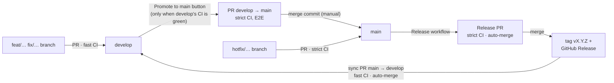

# GitHub automation

What runs on this repository, when, and why. The decisions behind it are in
[ADR-0015](../docs/adr/0015-develop-branch-flow-and-release-model.md) (branches, CI tiers,
releases) and [ADR-0002](../docs/adr/0002-conventional-branch-and-commit-naming.md) (branch and
PR naming); the conventions every workflow follows are in
[CI workflow standards](../docs/development/ci-workflow-standards.md).

## The rules in one paragraph

Feature work merges fast into `develop`; `main` only takes release-grade code. **`main` never
skips a test or uses a cache**: every run on or into `main` builds and tests everything from
scratch, E2E included. Only `develop` and `hotfix/*` branches open PRs into `main` (plus the
release bot's own Release PR). Merging `develop → main` is the one manual step of a release;
versioning, changelog, tag and the sync back to `develop` are automatic.

## How code moves



## Workflows

| File                 | Name             | Runs on                                       | Does                                                                                             |
| -------------------- | ---------------- | --------------------------------------------- | ------------------------------------------------------------------------------------------------ |
| `ci.yml`             | `CI`             | PRs into and pushes to `develop`/`main`, manual | Calls `ci-jobs.yml`; reports the one required code check, **`CI / Gate`**                       |
| `ci-jobs.yml`        | `CI jobs`        | Called by `ci.yml` only                       | Plan + Repository integrity → Lint, Type check, Unit tests, Architecture, Build, Integration, E2E → Gate → Slack card                 |
| `pr-conventions.yml` | `PR conventions` | Every PR (also on edits)                      | **`PR title`** and **`Branch policy`** (required); `PR autofill` titles a new PR from its branch |
| `promote.yml`        | `Promote to main` | Manual, from `develop`                       | Opens or refreshes `Chore \| Promote develop to main`, only if `develop`'s tip has a green Gate  |
| `release.yml`        | `Release`        | Pushes to `main`                              | release-please: Release PR, then tag and GitHub Release, then the `main → develop` sync PR       |
| `bots.yml`           | `Review bots`    | PR events, comments, manual                   | Advisory Claude or Codex reviews; never a required check                                         |

## Which CI tier runs

The tier is decided in one place, [`scripts/policy/plan.mjs`](scripts/policy/plan.mjs), from the
event; the YAML only carries it out.

| Event                                                   | Tier       | What it means                                                 |
| ------------------------------------------------------- | ---------- | ------------------------------------------------------------- |
| PR into `develop`                                       | fast       | Touched packages only, caches restored, no E2E                |
| Push to `develop` that merges a feature PR              | fast       | Same, and saves the caches PRs restore                        |
| Push to `develop` that is direct, or merges `main`/`hotfix/*` | strict | Everything from scratch, E2E; still saves caches         |
| PR into `main` (any source), push to `main`             | **strict** | Everything from scratch (`--force`), nothing restored or saved, E2E required |
| Manual run on any branch but `main`                     | fast       | Checkboxes: skip caches, or run the full suite with E2E       |
| Manual run on `main`                                    | **strict** | Checkboxes ignored                                            |

A strict `CI / Gate` fails unless **every job in its `needs`** succeeded (the Slack card and evidence publishing only report, outside it), and a test pins that every test job feeds the Gate; a fast one accepts jobs skipped because
the change didn't touch them (a docs-only PR skips the code checks).

## Required checks and rulesets

Set in **Settings → Rules**, not in this folder. Both branches require `CI / Gate`, `PR title`
and `Branch policy` (GitHub Actions source), resolved conversations, and block force-push and
deletion, with **no bypass actors**.

- `main`: merge commits only, branch must be up to date.
- `develop`: squash or merge commits, no up-to-date requirement.
- Tags `v*`: only the release-bot App creates them; nobody updates or deletes them.

Renaming a required job (`Gate`, `PR title`, `Branch policy`) breaks merging until the ruleset
is updated. Adding or renaming any other CI job only needs `ci-jobs.yml` and the Gate's `needs` (`main-invariants.test.mjs` fails if a job is left out).

## Conflict markers and staged diffs

`Repository integrity` scans every tracked text blob on every CI run, including docs-only
plans, and feeds `CI / Gate`. The pre-commit hook runs the same index scan and
`git diff --cached --check` before formatting. Failures stop the commit; fix and rerun the
checks before commit, push or PR publication. See [the exact contract and example
handling](../docs/development/repository-integrity.md).

## Credentials

| Credential                                     | Used by                          | Why                                                                                                                       |
| ---------------------------------------------- | -------------------------------- | ------------------------------------------------------------------------------------------------------------------------- |
| `GITHUB_TOKEN` (built in)                      | Most jobs, read-only by default  | Reading the repo and PRs. Anything it opens or pushes **triggers no workflows**                                           |
| `RELEASE_APP_ID`, `RELEASE_APP_PRIVATE_KEY`    | `release.yml`, `promote.yml`     | The release-bot App. PRs it opens run CI like any PR, so required checks report. Each job narrows its token to what it uses |
| `SLACK_WEBHOOK_URL` (optional)                 | `ci-jobs.yml` → Notify           | Run-result card for pushes; skipped when unset                                                                            |
| `CLAUDE_CODE_OAUTH_TOKEN`, `AUTO_REVIEW_TOKEN` | `bots.yml`                       | Claude reviews; switching the `AUTO_REVIEW` variable                                                                      |

Security rules every workflow follows: actions pinned to a full commit SHA; checkouts keep no
credentials (`persist-credentials: false`); event fields reach shell through `env:`, never
inline; permissions start at `contents: read` and jobs ask for more only where needed.

## Folder map

```
.github/
├── workflows/        triggers, permissions and wiring; no decisions
├── actions/
│   ├── setup/        pnpm + Node + cache restore + frozen install
│   └── save-cache/   cache save, only on the producer branch
├── scripts/          entry points that workflows and git hooks run
│   ├── ci-cli.mjs              plan · verdict · branch-policy · pr-title · promote
│   ├── ci-report-cli.mjs       renders a report template (Slack card)
│   ├── ci-e2e-cli.mjs          E2E failure report · evidence pruning
│   ├── validate-branch-name.mjs  the pre-push hook
│   ├── publish-evidence.sh     screenshots to the ci-evidence branch (opt-in)
│   ├── ci-policy.mjs           one import for every rule below
│   ├── policy/       pure rules, one per file, each with its test
│   │   ├── config.mjs          the data: branch names, path groups, tier patterns
│   │   ├── branches.mjs        branch naming; who may target main
│   │   ├── plan.mjs            tier and job plan for one run
│   │   ├── verdict.mjs         CI / Gate from every job's result
│   │   ├── pr-title.mjs        `Feature | #12 | Add x` and its commit override
│   │   ├── promotion.mjs       when the Promote button may open the release PR
│   │   └── main-invariants.test.mjs   main never skips a test or uses a cache
│   └── report/       pure report rendering (templates, themes, E2E parsing)
├── config/           report themes, templates and settings (JSON/Markdown)
├── dependabot.yml    weekly Actions and npm updates into develop
├── CODEOWNERS
└── PULL_REQUEST_TEMPLATE.md
```

## Changing something

| To change…                                   | Edit                                                       |
| -------------------------------------------- | ---------------------------------------------------------- |
| Which paths count as code, or trigger integration tests | `scripts/policy/config.mjs`                     |
| When a run is fast or strict                 | `scripts/policy/plan.mjs` (and its test); then ADR-0015     |
| What makes `CI / Gate` fail                  | `scripts/policy/verdict.mjs`                               |
| Branch names or who may target `main`        | `scripts/policy/config.mjs`, `scripts/policy/branches.mjs`; then ADR-0002 |
| The PR title format                          | `scripts/policy/pr-title.mjs`; then ADR-0002               |
| A CI job's steps                             | `workflows/ci-jobs.yml`; add new jobs to the Gate's `needs` |
| A report's wording or colours                | `config/templates/`, `config/themes.json`                  |

Run every script test locally with `node --test '.github/scripts/**/*.test.mjs'` (the `Plan` job
runs the same command before planning).
