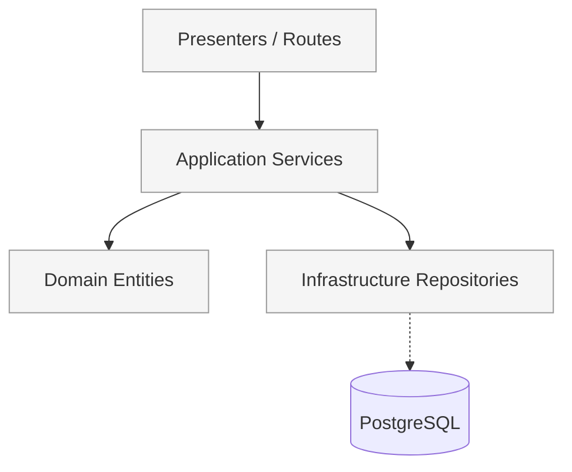
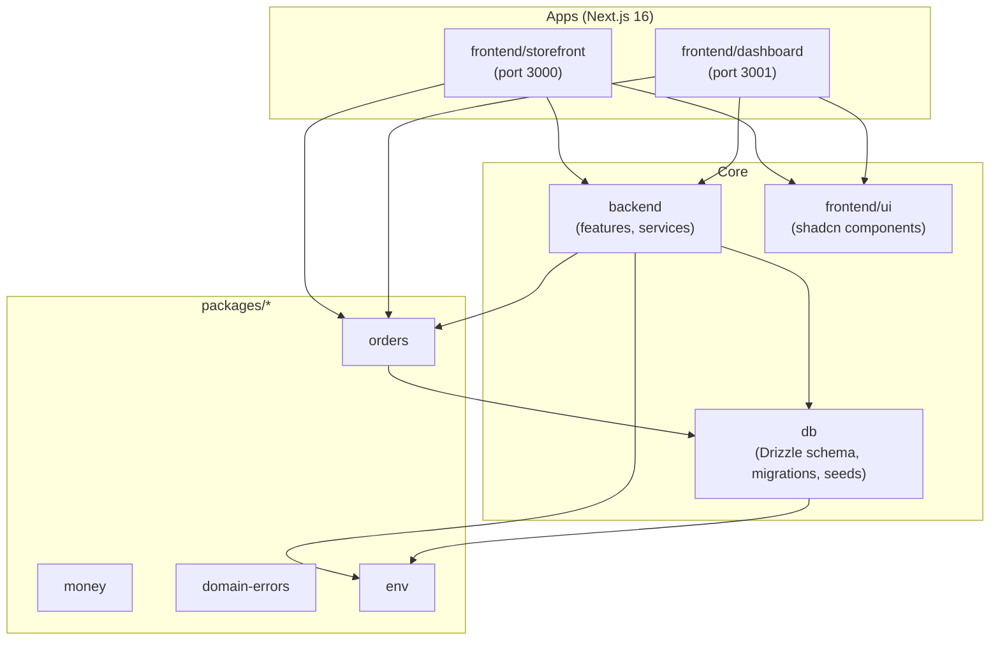

# FindEg.com — Stationery & School Supplies Marketplace

Welcome to the FindEg.com monorepo. This project is a modern, hierarchical marketplace platform designed to provide a premium experience for both B2C (Public Shop) and B2B (School Lists) customers.

---

## 👔 Executive Summary

### Purpose

FindEg.com is structured as a **distributed monorepo** to enable rapid, independent development of its core business pillars: the storefront and the administration dashboard. By separating concerns while sharing a robust core, we maximize developer focus, reduce build times, and ensure cross-platform consistency.

### Key Goals & Current Matrix

- **Performance**: Optimized Next.js 16 build pipelines with Turborepo caching.
- **Scalability**: Clean Architecture ensures we can grow features without technical debt sprawl.
- **Accessibility**: A bilingual (EN/AR), RTL-first platform designed for the Egyptian market.

**MVP Status**:

- Backend: ~80% Complete (Clean Arch, ServiceResults)
- Dashboard: ~60% Complete (Products/Catalog Admin)
- Storefront: ~50% Complete (Browse/Cart UI)

### Stakeholder Overview

- **Product Owners**: High-level visibility into feature modules and business-critical flows.
- **Developers**: Hierarchical documentation for fast onboarding.
- **DevOps**: Independent deployment strategies for every package.

---

## 🏢 Business Overview

FindEg.com serves two primary audiences in the Egyptian market:

1. **Public Shop (B2C)**: A high-performance e-commerce experience for stationery, office supplies, and art materials. Incorporates advanced search, category browsing, multi-variant products, and a streamlined checkout.
2. **School Lists (B2B)**: A private, authorized lookup system where parents can access grade-specific supply lists via school-issued secure links or QR codes safely, with targeted one-click cart kits.

---

## 🛠️ Technology Stack & Architecture Overview

- **Framework**: [Next.js 16](https://nextjs.org/) (App Router, Server Actions, PPR).
- **Core Library**: React 19 / DOM.
- **ORMs**: [Drizzle ORM](https://orm.drizzle.team/) with PostgreSQL 16.
- **Styling**: Vanilla CSS + [Tailwind CSS 4](https://tailwindcss.com/) (Logical properties for RTL).
- **Validation**: [Zod](https://zod.dev/) for cross-boundary type safety.
- **i18n**: [next-intl](https://next-intl-docs.vercel.app/) for bilingual implementation.
- **Tooling**: [Turborepo](https://turbo.build/) + `pnpm 11` workspaces for monorepo orchestration.
- **Testing**: `vitest` for localized logic testing, `cypress` for overarching E2E testing.



---

## 📦 Monorepo Package Map & Integration

FindEg is a Turborepo + pnpm workspace (`pnpm-workspace.yaml`). Apps live under `frontend/`, the business kernel in `backend/`, the database in `db/`, and small shared libraries under `packages/`. Workspace packages depend on each other via `"@findeg/<name>": "workspace:*"`.



`money` and `domain-errors` are used across the apps, `backend` and `orders`; `config` (lint profiles) is a dev dependency of every package. Arrows to them are left out for readability.

| Package                                                  | Path                      | Purpose                                                                                       | Dev command                            |
| -------------------------------------------------------- | ------------------------- | --------------------------------------------------------------------------------------------- | -------------------------------------- |
| [**@findeg/storefront**](frontend/storefront/README.md) | `frontend/storefront`     | Customer-facing Next.js app (port 3000).                                                      | `pnpm --filter @findeg/storefront dev` |
| [**@findeg/dashboard**](frontend/dashboard/README.md)   | `frontend/dashboard`      | Staff admin Next.js app (port 3001).                                                          | `pnpm --filter @findeg/dashboard dev`  |
| [**@findeg/ui**](frontend/ui/README.md)                 | `frontend/ui`             | Shared design system & shadcn primitives.                                                     | N/A                                    |
| [**@findeg/backend**](backend/README.md)                | `backend`                 | Pure TypeScript business kernel: feature modules, services, entities.                         | N/A                                    |
| **@findeg/db**                                           | `db`                      | Drizzle tables, migrations and seeds ([docs](db/docs/SETUP.md)).                              | `pnpm db:setup`, `pnpm db:studio`      |
| [**@findeg/orders**](packages/orders/README.md)         | `packages/orders`         | Order reads and Staff lifecycle commands.                                                     | N/A                                    |
| **@findeg/domain-errors**                                | `packages/domain-errors`  | Shared domain error classes.                                                                  | N/A                                    |
| **@findeg/env**                                          | `configs/env`             | Validated environment variables.                                                              | N/A                                    |
| **@findeg/domain**                                       | `packages/domain`         | Business domain: pure values, value objects and rules, depending only on zod ([ADR-0018](docs/adr/0018-domain-package-is-the-pure-rich-business-domain.md)). | N/A                                    |
| [**@findeg/config**](packages/config/README.md)         | `packages/config`         | Shared lint profiles.                                                                         | N/A                                    |

---

## 🚀 Build, Docker & Deployment Strategy

### Build Lifecycle

The monorepo uses **Turborepo** (`turbo.json`) and `pnpm workspaces`.

- `pnpm build`: Rebuilds cacheable outputs (`dist/**`, `.next/**`) across all workspace packages in dependency order.
- `pnpm dev`: Starts the Postgres container, then runs every package's `dev` task (storefront on 3000, dashboard on 3001).
- `pnpm type-check`, `pnpm lint`, `pnpm test`: Run the matching task in every package.
- `pnpm --filter <package> <cmd>`: Runs a command in one package, e.g. `pnpm --filter @findeg/backend test`.

### Docker Configuration

Local persistence uses `docker-compose.yml` to orchestrate a PostgreSQL 16 Alpine container:

- **Image**: `postgres:16-alpine`
- **Volume**: Native volume storage to `/var/lib/postgresql/data` ensuring state lives across reboots.
- **Port Mapping**: `${DB_PORT}:5432` (from `.env`)
- **Init script**: `db/init-db.sql` runs on first start.

### Deployment & CI Validation

CI gates every merge:

1. `CI` (`ci.yml`) runs on PRs into and pushes to `develop` and `main`: the fast tier for feature work, the strict tier for the release path and hotfixes. It calls the jobs in `ci-jobs.yml` (lint, type check, unit tests, build, integration tests, and strict-only E2E) behind one required check, `CI / Gate`.
2. Vercel automatically deploys based on application boundaries.

`Release` runs on pushes to `main`: release-please maintains a bot-authored Release PR, enables merge-commit auto-merge, publishes the version tag and GitHub Release, then opens or updates a `main → develop` sync PR with merge-commit auto-merge. The root package and manifest share one product version. See [automated releases](docs/operations/releases.md) for configuration, recovery and the first-release acceptance checklist.

---

## 🔧 Quick Start & Environment Setup

Ensure you have Node.js 24 (see `.nvmrc`), `pnpm 11`, and `Docker` installed.

1. **Setup Environment**:
   ```bash
   cp .env.example .env
   # docker-compose and the db scripts read DB_* and DATABASE_URL from .env
   ```
2. **Install Dependencies**:
   ```bash
   pnpm install
   ```
3. **Database Spinup (Docker)**:
   ```bash
   pnpm db:setup
   # Starts Postgres, then runs drizzle-kit generate, drizzle-kit push and db/seed.ts
   ```
4. **Development Mode**:
   ```bash
   pnpm dev
   ```

### Test Accounts

`pnpm db:setup` seeds staff and customer accounts from `db/seeds/data/users.json`, with roles from `user_roles.json`. Accounts without an explicit password in the seed data get `password123` (`db/seeds/identity.ts`).

---

## 📐 Engineering Standards

### Coding Rules

- **No Direct Imports**: Frontend code MUST import from `@findeg/backend` and NEVER `../../backend/src`.
- **RTL-First CSS**: Use Tailwind's logical properties (`ps-4`, `me-2`) instead of physical ones (`pl-4`, `mr-2`) so the system elegantly maps English/Arabic alignments.
- **ServiceResult Protocol**: All backend services do NOT throw standard JS errors; they return an `Err` or `Ok` standard `ServiceResult<T, FindEgError>`.

### Testing Pipeline

- **Unit (Vitest)**: Every exported catalog service, checkout compute engine, and validation module is independently tested. Mocks are isolated.
- **Integration (Vitest + Postgres 16)**: `backend/src/**/*.integration.test.ts` run against a real database, for behaviour mocks can't reproduce (row locks, unique indexes, races). See [Running integration tests](#running-integration-tests).
- **E2E (Cypress)**: Run `pnpm --filter @findeg/storefront e2e:run:ci` and `pnpm --filter @findeg/dashboard e2e:run:ci` against built apps on ports 3000 and 3001. Install the binary explicitly with `pnpm --filter @findeg/storefront exec cypress install` (pnpm disables its postinstall). The strict tier builds both apps without caches against a freshly migrated, seeded PostgreSQL database and runs both suites; the fast tier skips E2E. On the strict tier, `CI / Gate` requires E2E success, rejecting skipped or missing results. Failed runs upload screenshots, videos and app logs as `e2e-failure-evidence`. Do not commit brittle selector targeting; use proper `data-cy` attributes.

### Running integration tests

```bash
pnpm db:run            # start the docker-compose Postgres (uses DB_* from .env)
pnpm test:integration  # backend integration tests only; `pnpm test` still runs unit tests only
```

Each run creates a fresh `findeg_it_<timestamp>_<id>` database on that server, applies `db/init-db.sql` and every migration in `db/migrations`, and drops it when the run ends, so runs never share state and your dev data is untouched. Databases left behind by killed runs are dropped by the next run once they're over 6 hours old. Test files within a run share the database and run one at a time, so use unique data per test. To target another server, set `INTEGRATION_DATABASE_URL` (a URL to any database on it whose user can `CREATE DATABASE`); CI does this with a Postgres 16 service container.

Write tests as `*.integration.test.ts` under `backend/src` and use the helpers in `backend/src/testing/postgres`: `connectToTestDatabase()` for a Drizzle/postgres.js handle, `runConcurrently()` to run two operations on separate connections (each is given its peer's backend pid), and `waitUntilBlocked(sql, peer.pid)` to hold a lock until the peer is provably blocked on it.

---

## 🗺️ Master System Specs & Guide Book

FindEg uses a strict **3-tier documentation hierarchy** to capture deep technical constraints. This document serves as the root index. Navigate the system using the structured references below:

### 1. The Core Data & API Layer (Backend)

**[Tier 2: Backend Architecture & Standards](./backend/README.md)**

- **System Schema**: [Drizzle Constraints, Migrations, & JSONB ER Diagram](./db/docs/SCHEMA.md) · [Database Setup](./db/docs/SETUP.md) · [Taxonomy](./db/docs/TAXONOMY.md)
- **Orders**: [`@findeg/orders`](./packages/orders/README.md) — Order reads, Staff lifecycle commands.
- **Tier 3 Feature Domains (Node/Services)**:
  - [Catalog](./backend/src/features/catalog/README.md) — Products, Arrays, Search execution.
  - [Identity](./backend/src/features/identity/README.md) — JWTs, RBAC gating, Hashing constraints.
  - [Cart](./backend/src/features/cart/README.md) — Transient user selection and unit verification.
  - [School](./backend/src/features/school/README.md) — B2B token access layers.
  - [Guest Access](./backend/src/features/guest-access/README.md) — Guest order access.
  - [Partner Membership](./backend/src/features/partner-membership/README.md) — Business partner memberships.
  - [Partner Sales](./backend/src/features/partner-sales/README.md) — Attributed order reads.
  - [Outbox](./backend/src/features/outbox/README.md) — Transactional outbox events.
  - [Administration](./backend/src/features/administration/README.md) — Auditing streams, Config state.
  - [Notifications](./backend/src/features/notifications/README.md) — SES/SMTP interface boundaries.
  - [Media](./backend/src/features/media/README.md) — Storage interfaces, upload protections.
  - [Review](./backend/src/features/review/README.md) — UGC limits, Moderation bounds.
  - [Core](./backend/src/features/core/README.md) — Zero-dependency Value Objects, `ServiceResult`.

### 2. The Customer Interaction Layer (Storefront)

**[Tier 2: Storefront RSC Cache Architecture](./frontend/storefront/README.md)**

- **Tier 3 Data Domains (Next.js `src/data`)**:
  - [Catalog](./frontend/storefront/src/data/catalog/README.md) — RSC Grids, Search Params syncing.
  - [Cart](./frontend/storefront/src/data/cart/README.md) — `useOptimistic` Action bridges.
  - [Order](./frontend/storefront/src/data/order/README.md) — Address Checkouts, Payment iframes.
  - [School](./frontend/storefront/src/data/school/README.md) — Private token interception bounds.
  - [Review](./frontend/storefront/src/data/review/README.md) — Revalidation limits via Server Actions.
  - [Notifications](./frontend/storefront/src/data/notifications/README.md) — Ephemeral Toasts, Browser limits.

### 3. The Command Control Layer (Dashboard)

**[Tier 2: Dashboard UI State Architecture](./frontend/dashboard/README.md)**

- **Tier 3 Feature Domains (Next.js)**:
  - [Catalog Admin](./frontend/dashboard/src/features/catalog/README.md) — Massive hook-form Variant generation bounds.
  - [Administration Dashboard](./frontend/dashboard/src/features/administration/README.md) — Shared Sidebar routing logic.

### 4. The Shared Visual Language (UI)

**[Tier 2: UI Shadcn Monorepo Base](./frontend/ui/README.md)**
Contains Global RTL logical CSS mapping, unified utility functions, and foundational primitive rules applied to BOTH frontends.

### 5. Decisions & Guides

- [Architecture Decision Records](./docs/adr/) · [Glossary](./GLOSSARY.md) · [Architecture](./docs/architecture/) · [Development standards](./docs/development/) · [Releases](./docs/operations/releases.md)

---

## 📅 Roadmap & Status

- [x] Monorepo Infrastructure Migration & Typescript Typings
- [x] Application Base Models (Products, Brands, Taxonomy)
- [x] Admin Dashboard MVP (Product/Order management forms)
- [x] Documentation Restructuring (Deep System Guidebook complete)
- [ ] School List Private Access (Feature definition complete, integration pending)

---

&copy; 2026 FindEg.com. All rights reserved.
