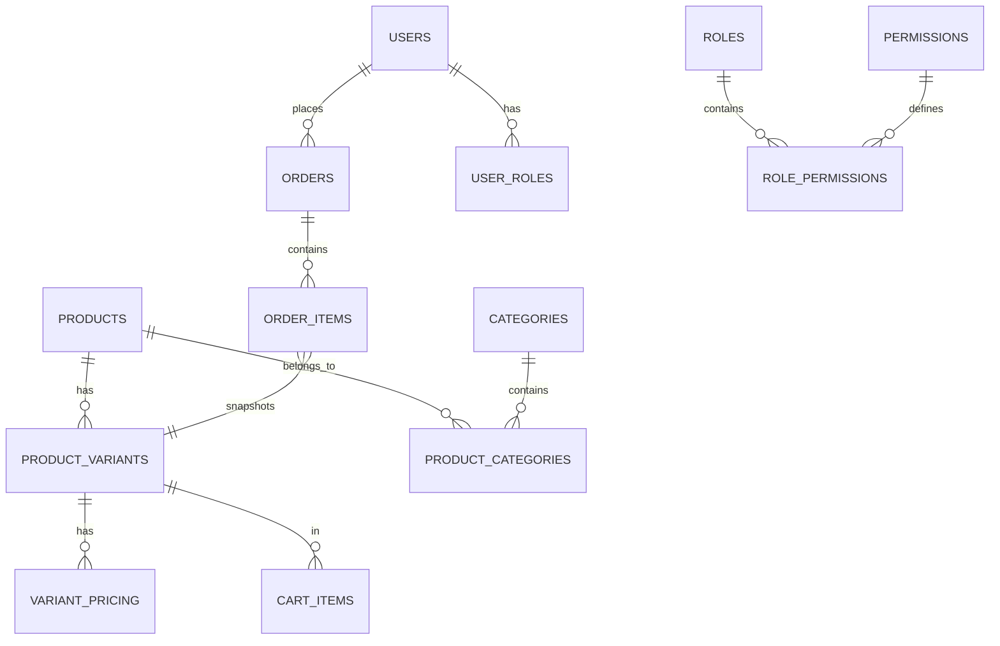

# FindEg Database Schema Reference

This document serves as the central reference for the FindEg marketplace data model. All schemas are strictly typed and managed via **Drizzle ORM** (scattered across feature modules in the backend) executing into PostgreSQL 16.

---

## 🗺️ Global ER Diagram



---

## 📦 Feature-Specific Tables & Complex Types

### 1. Catalog

- `products`: Base product metadata. **Important**: Uses `jsonb` fields for LocalizedStrings (`{ en: string, ar: string }`).
- `product_variants`: SKU-level entities.
- `categories`, `brands`, `tags`: Taxonomy nodes.
- `variant_pricing`: Physical price overrides based on `CustomerGroup`.

### 2. Identity

- `users`: Core profile data (`portalRole`, email).
- `password_credentials`: Separated hashes (Argon2 output).
- `roles`, `permissions`, `user_roles`: RBAC matrix.

### 3. Orders & Cart

- `orders`: Transaction headers.
- `order_items`: Line items strictly holding `jsonb` snapshots of variant pricing to protect against catalog updates.
- `carts`, `cart_items`: Ephemeral user basket headers.

### 4. School

- `partner_school_profiles`: A Partner School's governorate, area, school type, academic system and logo.
- `school_supply_lists`, `school_supply_list_items`: A Partner School's School Supply Lists (draft, published, archived) and their items.

---

## 🛠️ Management & Migrations

- **Location**: Scattered intentionally across `packages/backend/src/features/*/infrastructure/persistence/schema.ts`
- **Engine**: PostgreSQL 16.
- **ORM**: Drizzle.

### Essential Commands

```bash
pnpm db:generate   # Safely diff and generate migration SQL inside backend/drizzle
pnpm db:apply      # Apply migrations to target mapped environment
pnpm db:studio     # Open Drizzle introspection UI
```

> [!CAUTION]
> Never bypass Drizzle. All localized columns MUST use the `domain/value-objects` mapping tools to prevent null hydration failures on the backend router.

---

&copy; 2026 FindEg.com

## Domain mapping and compatibility

`@findeg/db` derives Order/payment enums and Partner/list CHECK values and bounds
from `@findeg/domain`. Domain Order References use the domain generator with
`node:crypto` randomness. These changes preserve generated migration SQL.

Drizzle select/insert rows and existing read projections retain decimal strings
and nullable historical references. The root entry exports explicit `mapOrderRow`,
`mapOrderItemRow`, `mapProductVariant`, `mapBusinessPartner`, `mapPartnerMembership`,
`mapSupplyList`, `mapSupplyListItem`, `mapStockBalance` and `mapWarehouse` adapters.
`mapProductVariantRow` retains internal cost as Money; `mapDiscountRuleRow` maps
fixed discounts and minimum spend while keeping percentage values as decimals.
They brand entity identities at the persistence boundary and convert decimal
strings to exact domain Money. Historical Order projections remain projections;
they do not invent missing buyers, variants or acceptance snapshots. Serialize
domain Money for persistence or JSON with `moneyToDecimal` from the domain;
never coerce it through floating-point pounds. Non-EGP Order rows cannot map to
EGP domain Money.

The existing `@findeg/db/types/enum-values` entry delegates to domain value exports
and db-owned session classifications until the consumer migration in #416.
Partner/list table exports remain compatible. Outbox statuses, portal roles,
actor types and Partner access audit values retain one owner in db. The existing
Staff permission registry remains here pending its separate ownership decision.

Available Stock clamps each balance to zero, then sums only active warehouses.
Low stock means 1 to 5 available units per variant. `getLowStock` retains its
per-warehouse balance projection and adds `available` for the variant's total;
its filtering uses that total rather than individual warehouse balances.
