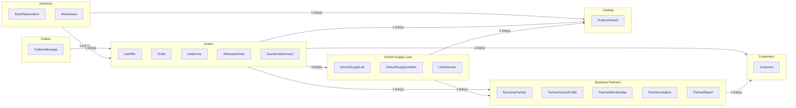
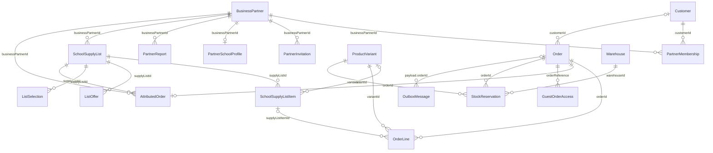

# Business-domain map

The final map of FindEg's business areas and how they relate. It is generated from the schema data in `packages/schema/src/relations`, and the diagrams are checked by the schema tests, so a relation that points at a missing entity fails the build.

## Business areas

| Domain | Entities | Glossary terms |
| --- | --- | --- |
| Customers | `Customer` | Customer |
| Business Partners | `BusinessPartner`, `PartnerSchoolProfile`, `PartnerMembership`, `PartnerInvitation`, `PartnerReport` | Business Partner, Partner School, Partner Membership, Partner Invitation, Partner Report |
| School Supply Lists | `SchoolSupplyList`, `SchoolSupplyListItem`, `ListSelection` | School Supply List, Exact Item, Allowed Alternative, List Selection |
| Orders | `ListOffer`, `Order`, `OrderLine`, `AttributedOrder`, `GuestOrderAccess` | List Offer, Order, Attributed Order, Guest Order Access |
| Catalog | `ProductVariant` | (variant of a product; referenced by lists and orders) |
| Inventory | `StockReservation`, `Warehouse` | Stock Reservation |
| Outbox | `OutboxMessage` | Outbox |

## Area dependencies

Each arrow reads "depends on": the source area stores an id that references the target area. Cross-area links are by id, never by object (ADR-0016).

## Entity relations

Each line is a link. The entity on the right stores the link in the field named on the line, and points at the parent on the left. `||` on the parent side means every child has exactly one parent (a required link); `|o` means the link is optional. `o{` means one parent has many children; `o|` means at most one.

## Settled decisions

| Area | Decision | Source |
| --- | --- | --- |
| Payment | Cash on delivery is accepted now. Card is defined in `PAYMENT_OPTIONS` as phase 2 and is not accepted. Enabling card is a data change, plus a `payment_method` enum migration. | ADR-0005, this review |
| Payment | A refund moves the order to `refunded` and its payment to `refunded` in the same transaction. Not implemented yet. | ADR-0005 amendment |
| Order status | `confirmed` is kept as a Staff step between `pending` and `processing`. It is not the Order Acceptance moment (that stays atomic and is not a status). | `ORDER_STATUS_TRANSITIONS` |
| Order status | Cancellation is allowed from `shipped` only once the parcel is back in the warehouse. | ADR-0005 |
| Partner status | `closed` is final. `onboarding` can go to `active` or `closed`; `active` and `suspended` move between each other and to `closed`. | `BUSINESS_PARTNER_STATUS_TRANSITIONS`, ADR-0012 |
| Membership | `ended` is terminal: no change from it. Reactivate applies only to `suspended`. | `PARTNER_MEMBERSHIP_STATUS_TRANSITIONS`, ADR-0003 |
| Invitation | `pending` can become `accepted` or `revoked`. Expiry after 7 days is derived from the date. | `PARTNER_INVITATION_STATUS_TRANSITIONS` |
| School Supply List | Draft → Published → Archived. Archived is set when a List Replacement supersedes it. Clones keep `sourceListId`; replacements keep `replacesListId`. | ADR-0004 |
| Stock | A reservation is held from acceptance to delivery or cancellation. The state is derived from the order, not stored. | ADR-0005 |
| Locations | All 27 Egyptian governorates. The list was 16, which was incomplete. | General knowledge, not from the repo. Staff to confirm the names used on profiles. |
| Currency | EGP only. The dashboard's USD product table is a bug. | `DEFAULT_CURRENCY` |
| Shipping | A flat fee from the backend, the same for every payment method until card has its own rule. | `DEFAULT_FLAT_SHIPPING_FEE` |
| Rewards | Not modelled. The rewards ledger was removed. | ADR-0013 |

## Validation

The schema tests check the map:

- every relation points at an entity that exists in `ENTITY_DOMAINS`
- no entity is left without a relation
- no relation is declared twice
- cross-area links use an id field or the Order Reference, never an object
- every link has exactly one parent per child
- payload references (outbox) are never required
- every status transition table targets only declared statuses; `closed`, `ended`, `accepted`, `archived` and `refunded` have no outgoing moves

Both diagrams were also checked by the Mermaid validator: the entity diagram and the area diagram are both valid.

## Open for Staff

1. The governorate names on school profiles must match the list above.
2. Whether `confirmed` should stay as a visible status for Customers.
3. The shipping rule for card, once card is enabled.
