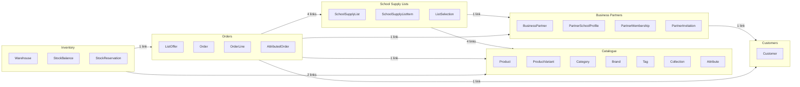
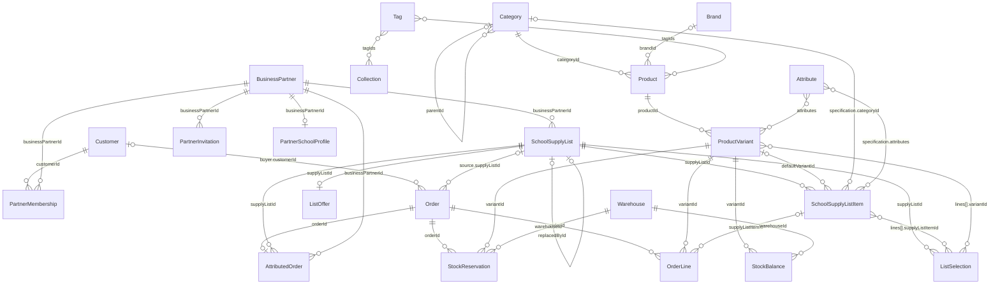

# Business-domain map

The map of FindEg's business areas and how they relate. The implemented relations are data in `packages/domain/src/relations` (`@findeg/domain/relations`). Existing tests check declared fields against the domain types, but do not yet prove that every model link is represented or targets the correct branded identity. The diagrams below describe the complete required business contract, including the missing links listed under Relation completeness. Tickets #408 and #442 own implementation and preservation of that contract; this documentation update does not implement those checks.

The map holds domain entities only; application plumbing (Outbox, Guest Order Access, idempotency) and the Partner Report query/read projection stay out. Pure Partner Report rule inputs and results remain in Domain. The diagrams are maintained by hand; no automatic check currently compares them with `RELATIONS`.

## Business areas

| Area                | Entities                                                                            | Glossary terms                                                                                                                                         |
| ------------------- | ----------------------------------------------------------------------------------- | ------------------------------------------------------------------------------------------------------------------------------------------------------ |
| Customers           | `Customer`                                                                          | Customer, Guest                                                                                                                                        |
| Catalogue           | `Product`, `ProductVariant`, `Category`, `Brand`, `Tag`, `Collection`, `Attribute`  | Product, Product Variant, Default Variant, Compare-at Price, Category, Brand, Tag, New Arrival, Collection, Attribute                                  |
| Inventory           | `Warehouse`, `StockBalance`, `StockReservation`                                     | Warehouse, Stock Balance, Available Stock, Stock Level, Stock Reservation                                                                              |
| Business Partners   | `BusinessPartner`, `PartnerSchoolProfile`, `PartnerMembership`, `PartnerInvitation` | Business Partner, Partner Code, Partner School, Partner Membership, Partner Invitation, Partner Report (a read model, not an entity)                   |
| School Supply Lists | `SchoolSupplyList`, `SchoolSupplyListItem`, `ListSelection`                         | School Supply List, Exact Item, Specification, Allowed Alternative, Substitute, Slot, Public Code, List Replacement, List Selection, List Completeness |
| Orders              | `ListOffer`, `Order`, `OrderLine`, `AttributedOrder`                                | Cart, Quote, Confirmation, Order, Order Status, Payment Status, Order Reference, List Offer, Attributed Order                                          |

The Cart, the Quote and the Confirmation are values without an identity of their own, so they are not entities in the map.

## Area dependencies

Each arrow reads "depends on": the source area stores ids that reference the target area, and the label counts those links. Cross-area links are by id, never by object (ADR-0018).

## Entity relations

Each line is a link. The entity on the right stores the link in the field named on the line, and points at the parent on the left. `||` on the parent side means every child has exactly one parent (a required link); `|o` means the link is optional. `o{` means one parent has many children; `o|` means at most one. `}o--o{` is a many-to-many link held as a list of ids (or, for attributes, as values keyed by the Attribute's key).

Notes on the optional links: a list item's default variant is missing only while its list is a draft, and an Exact Item has no specification. A guest buyer has no Customer, and a cart Order has no School Supply List. A list has at most one List Offer.

Selection links are collections of per-line references, not new entities. One selection contains at most one choice for each item; different items may choose the same variant. A clone references its source without replacing it; replacement links identify the previous and next list in a replacement chain.

## Relation completeness

These model references are required but are not yet recorded in the implemented relation map:

| Source                  | Reference                  | Target                  | Ownership              |
| ----------------------- | -------------------------- | ----------------------- | ---------------------- |
| School Supply List      | `sourceListId`             | School Supply List      | #408; preserve in #442 |
| School Supply List      | `replacesListId`           | School Supply List      | #408; preserve in #442 |
| School Supply List      | `replacedById`             | School Supply List      | #408; preserve in #442 |
| School Supply List Item | `specification.attributes` | Attribute keys          | #408; preserve in #442 |
| List Selection          | `lines[].supplyListItemId` | School Supply List Item | #408; preserve in #442 |
| List Selection          | `lines[].variantId`        | Product Variant         | #408; preserve in #442 |

The implementation must define collection paths explicitly and test both directions of the contract: declared paths exist and have the expected target identities; required model references are present in the map. Attribute-key maps need a named exception to branded-id validation. Any excluded aggregate-internal link needs an explicit reason rather than silently disappearing from the map.

## Settled decisions

The owner approved the rule changes marked _changed_ on 2026-10-12 (#402). The domain declares them, and #399 applies them in every layer.

| Area               | Decision                                                                                                                                                                                                                                                                                                                                                     | Source                                     |
| ------------------ | ------------------------------------------------------------------------------------------------------------------------------------------------------------------------------------------------------------------------------------------------------------------------------------------------------------------------------------------------------------ | ------------------------------------------ |
| Money              | EGP with exactly two decimals (`12.00`, `12.99`), never negative, stored as `decimal(…, 2)`. Input with more than two decimals is refused, never rounded. Prices include VAT. _Changed_: never negative.                                                                                                                                                     | ADR-0018, CO-9                             |
| List Offer         | Each line total is `roundHalfUp(gross × (10000 − bps) / 10000)`, rounded to two decimals once per line; the discount is gross minus line total. A list has at most one List Offer; it applies when `startsAt ≤ at < endsAt`, and an offer with no end is open-ended. It applies to every line of the list's Order, whether or not the selection is complete. | ADR-0007                                   |
| Payment            | Cash on delivery is the only accepted payment method. Card is defined but not accepted.                                                                                                                                                                                                                                                                      | ADR-0005, CO-6                             |
| Payment            | _Changed_: payment becomes `paid` only once the Order is delivered.                                                                                                                                                                                                                                                                                          | CO-12                                      |
| Refund             | _Changed_: a Refund moves a delivered, paid Order and its payment to `refunded` together. A payment is never refunded alone.                                                                                                                                                                                                                                 | ADR-0005 amendment, CO-13                  |
| Order status       | `confirmed` is kept between `pending` and `processing`, is visible to Customers and means "confirmed by phone". It is not the Order Acceptance moment.                                                                                                                                                                                                       | CO-18                                      |
| Order status       | _Changed_: cancelling a shipped Order requires Staff to state that the parcel is back in the warehouse.                                                                                                                                                                                                                                                      | ADR-0005, CO-13                            |
| Status changes     | A same-status change is a no-op for Order status, payment status and Partner Membership. For a Business Partner and a Partner Invitation it is refused.                                                                                                                                                                                                      | ADR-0016                                   |
| Notifications      | Customers are notified of `shipped`, `delivered` and `cancelled`. There is no refund email.                                                                                                                                                                                                                                                                  | CO-16                                      |
| Contact            | _Changed_: every Order has an Egyptian mobile number, and a guest Order also has an email.                                                                                                                                                                                                                                                                   | CO-19                                      |
| Shipping           | _Changed_: one flat fee of 50.00 EGP, declared in the domain, with no environment override.                                                                                                                                                                                                                                                                  | CO-7                                       |
| Time               | Months and dates are bucketed in Africa/Cairo time everywhere.                                                                                                                                                                                                                                                                                               | PA-14                                      |
| Stock              | _Changed_: Available Stock is on hand minus reserved, summed over active warehouses, never below zero; low stock is 1 to 5 available units.                                                                                                                                                                                                                  | CA-9, CA-10                                |
| Stock              | A reservation is held from Order Acceptance, consumed on delivery and released on cancellation; its state follows the Order. Stock is allocated greedily across active warehouses, all or nothing.                                                                                                                                                           | ADR-0005, CO-4, CO-11                      |
| Catalogue          | _Changed_: the Default Variant is the variant flagged default, otherwise the first. A Compare-at Price is always above the price. Products and categories are Active or Inactive, never Draft. _Changed_: New Arrival means the `new-arrival` tag.                                                                                                           | CA-1, CA-3, CA-11, CA-12                   |
| Partner status     | `closed` is final. `onboarding` can go to `active` or `closed`; `active` and `suspended` move between each other and to `closed`. Activation needs an active Partner Administrator.                                                                                                                                                                          | ADR-0012, PA-17                            |
| Partner access     | _Changed_: two separate named rules: the partner action table (Workspace read, membership changes, reports; a closed partner keeps reports only) and the Staff list-authoring rule (draft while onboarding, active or suspended; publish or replace only while onboarding or active; archive in any status). The values are unchanged.                       | ADR-0012, ADR-0014 amendments, PA-3, SL-13 |
| Membership         | `ended` is terminal: no change from it. Reactivate applies only to `suspended`.                                                                                                                                                                                                                                                                              | ADR-0003, PA-8                             |
| Invitation         | `pending` can become `accepted` or `revoked`. Sending and resending set the expiry to 7 days later; it is expired once that moment has come.                                                                                                                                                                                                                 | PA-9                                       |
| Partner Report     | One row per month, list, item and variant, over Live Orders only. A row from fewer than 3 distinct Orders is folded into "Other items", so totals still add up, and no Order count is ever shown.                                                                                                                                                            | ADR-0010, PA-14                            |
| Directory          | _Changed_: a Partner School is listed only when it has at least one published list.                                                                                                                                                                                                                                                                          | PA-18                                      |
| School Supply List | Draft → Published → Archived. Archived is set when a List Replacement supersedes it, and the replacement copies its List Offer. Clones keep `sourceListId`; replacements keep `replacesListId`.                                                                                                                                                              | ADR-0004, ADR-0007                         |
| Locations          | All 27 Egyptian governorates, shared by shipping addresses and Partner School Profiles.                                                                                                                                                                                                                                                                      | General knowledge, not from the repo       |
| Currency           | EGP only.                                                                                                                                                                                                                                                                                                                                                    | `DEFAULT_CURRENCY`                         |
| Rewards            | Not modelled. The rewards ledger was removed.                                                                                                                                                                                                                                                                                                                | ADR-0013                                   |

## Validation

The relation tests check the map:

- every relation points at an entity that exists in `ENTITY_DOMAINS`
- the map names exactly the entities the domain exports, and no application plumbing or read projection
- every relation's field really exists on its entity (checked by the type-check)
- no entity is left without a relation
- no relation is declared twice
- cross-area links use an `…Id` field, never an object
- an `…Id` field names one parent; an id list or an attribute map names many
- the catalogue, Order and List Offer links are pinned by name

Both updated diagrams parse successfully with Mermaid. The completeness additions above remain the required target; #408 must complete the executable relation contract, and #442 must preserve it. Nothing currently re-checks the diagrams against the implemented relation data automatically.

## Delivery ownership

| Work                                          | Spec / tickets           | Completion contract                                                                                                                                                |
| --------------------------------------------- | ------------------------ | ------------------------------------------------------------------------------------------------------------------------------------------------------------------ |
| Pure business domain                          | #402 / #403–408; PR #433 | Review the existing implementation and complete missing relation contracts; no consumer migration here.                                                            |
| Domain adoption and approved behavior changes | #399 / #409–416          | Preserve compatibility until every consumer, including Backend facades, migrates; #411 delegates the temporary server cart and #421 later deletes it.              |
| Customer and Partner Workspace flows          | #400 / #417–423          | Independent groundwork may start early; final acceptance combines List Selection, Quote, acceptance and tracking, real-data reports, full en/ar and RTL.           |
| Staff flows                                   | #401 / #424–431          | #425 authorization ships independently first; suspended drafting stays allowed. Final acceptance checks real persisted outcomes and every surviving screen.        |
| Standards                                     | #434 / #435–444 and #445 | Build on Domain, preserve temporary entries until #443, and measure resulting app/library code before further remediation. #416 owns the guard; #444 preserves it. |

Parent dependencies on #399 are final completion gates, not blanket start gates inherited by all app children. GitHub native blocking links are authoritative for individual ticket prerequisites. The coordinated execution graph is maintained on #434; older closed Wayfinder maps remain historical records.

Draft/edit is allowed while a Business Partner is onboarding, active or suspended, and refused while closed. Publish/replace is allowed only while onboarding or active. Archive, read and setting a List Offer have no partner-status gate. These are action-specific rules, not one general “partner can author” predicate.

Exact Money remains bigint inside Domain; consumer HTTP/storage boundaries explicitly convert to and from two-decimal strings. JSON DTOs, authentication/permission registries and Confirmation tokens/hashing remain application concerns. Unsettled interface/permission ownership questions are recorded with owners on #402/#399 and must be resolved before the affected contraction/integration step.

## Open for Staff

1. The governorate names on school profiles and addresses must match the list above.
2. The shipping rule for card, once card is enabled.
