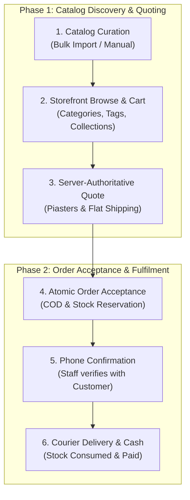
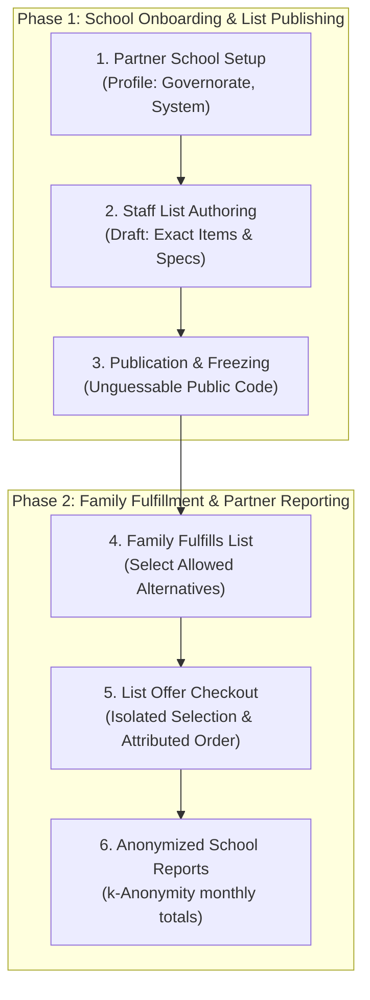

# FindEg business

FindEg is a stationery e-commerce business in Egypt, also selling gifts and toys: Customers buy from the FindEg catalog and pay cash on delivery.

To grow, FindEg is adding a **Partner Program** (B2B2C): services for the biggest business customers in the stationery market that make buying easier between them and their own clients. Schools are the first Partner Segment. Their Partner Service is the School Supply List: the school prepares one list, and families get it delivered in one click. Other segments wait until schools are stable.

The first launch is the stationery store. It waits on the dashboard, which Staff need for uploading the catalog and content. The school milestone does not block that launch.

This folder documents the business only: what each area is for, who uses it, what it can do, and the rules it must keep.

As of 2026-10-12.

## Positioning

| Date | Decision |
|---|---|
| 2026-10-11 | FindEg is a stationery e-commerce business that also sells gifts and toys. The Partner Program is a growth extension built on top of it, not the core. |
| 2026-10-11 | The first launch is the stationery store. Its blocker is the dashboard: Staff must be able to upload the catalog and content. The school milestone does not block it. |
| 2026-10-11 | Schools are the first Partner Segment; other segments are not planned for the near future. |
| 2026-10-11 | In the Partner Program, a partner's clients are Customers (families, who buy). Students are not modelled. A school buying for its own use is not part of the program. |
| 2026-10-11 | The money relationship between FindEg and a partner is not settled. The program is defined by its service to families and schools. |
| 2026-10-12 | Every business value, entity, relation and rule is declared once, in the domain package ([ADR-0018](../adr/0018-domain-package-is-the-pure-rich-business-domain.md)). The owner approved the rule changes and defaults it settles; they are recorded on the area pages and in the [business-domain map](../business-domain-map.md). |

## Enterprise Blueprints & System Diagrams

FindEg maintains a formal enterprise architectural atlas documenting capabilities, user journeys, and data pipelines across the system:

- 🏛️ **[Enterprise System Architecture](enterprise-system-architecture.md)**: C4 Level 1 System Context, Clean Architecture multi-tier layers, Business Capability Map, DDD Bounded Contexts, and Unified Tri-State Synchronization Engine.
- 🔄 **[User Flow Diagrams](user-flows-and-diagrams.md)**: Complete end-to-end journey maps for Storefront Customers, School Families, Guest Lookups, Partner Administrators, Report Viewers, and Operations Staff.
- 🔀 **[Data Flow Diagrams](data-flow-diagrams.md)**: DFD Level 0 Context and DFD Level 1 sub-system flows for Catalog Ingestion, Quoting/Acceptance, Dynamic Alternative Resolution, Fulfillment, Anonymized Reporting, and the Transactional Outbox.
- ⚡ **[Technical Sequence Diagrams](system-sequence-diagrams.md)**: Multi-tier interaction flows (SEQ-1 through SEQ-9) connecting Actor, Client Components, Server Actions, Core Services, Database Transactions, and Outbox.
- 📋 **[System Specifications](system-specifications.md)**: Formal functional specifications, data schemas, API contracts, invariant constraints (`CA-*`, `CO-*`, `ID-*`, `PA-*`, `SL-*`), and non-functional guarantees.
- 🎨 **[UI/UX Requirements & User Journeys](ui-ux-requirements-and-user-journeys.md)**: 6 persona journey maps, design system foundation (Cairo/Inter bilingual typography, RTL logical properties), and screen-by-screen UX specifications.

### Dual Value Stream Overview

#### Value Stream 1: Core B2C Stationery E-Commerce

#### Value Stream 2: B2B2C School Supply Lists (Partner Program)

## First launch: the stationery store

Decided 2026-10-11. The store launches when all of these are true:

| # | Requirement | Area |
|---|---|---|
| 1 | Staff can add products one by one in the dashboard, and import them in bulk from a spreadsheet | [Catalog](catalog-and-merchandising.md) |
| 2 | Staff can add product images from supplier files and from FindEg's own photos | [Catalog](catalog-and-merchandising.md) |
| 3 | Launch content exists: home banners and featured sections, collections (including gift guides), and the about, delivery, returns and privacy pages | [Catalog](catalog-and-merchandising.md) |
| 4 | Three Staff Roles work: Administrator, Catalog & Content Editor, Operations | [Identity](identity-and-administration.md) |
| 5 | Checkout offers only cash on delivery, shows the same flat shipping fee FindEg charges, and treats confirmed as "Staff phoned the Customer" | [Checkout](checkout-and-orders.md) |

A blog, other Staff Roles and the school milestone come after launch.

## Areas

### Core: stationery e-commerce

| Area | Business clarity | Terms | Known gaps | Main open point |
|---|---|---|---|---|
| [Catalog & Merchandising](catalog-and-merchandising.md) | Launch scope and model decided; reviews not documented | 13 decided, 2 proposed | 5 | Who may review, and whether reviews are moderated |
| [Checkout & Orders](checkout-and-orders.md) | Clear | 14 | 7 (2 launch blockers) | Card payment design, after launch |
| [Identity & Administration](identity-and-administration.md) | Launch roles decided; permissions provisional | 4 decided, 5 proposed | 1 | Exactly what each Staff Role may do |

### Growth: Partner Program (first segment: schools)

| Area | Business clarity | Terms | Known gaps | Main open point |
|---|---|---|---|---|
| [Partners](partners.md) | Clear, except money | 14 | 2 | Money between FindEg and a partner |
| [School Supply Lists](school-supply-lists.md) | Clear | 13 | 2 | The list page never shows the List Offer |

The catalog model is now decided, so Identity & Administration is the least documented area.

**Clarity**: _Clear_ means the terms and rules are decided. _Not documented_ means the page only describes how the product behaves today; every rule on it is unconfirmed until the business decides it.

## Open questions

Each area page ends with its own checklist of open questions, each with a suggested owner. Tick an item once its answer is recorded on the page.

| Page | Before launch | Later |
|---|---|---|
| [Catalog & Merchandising](catalog-and-merchandising.md) | 6 | 4 |
| [Checkout & Orders](checkout-and-orders.md) | 7 | 1 |
| [Identity & Administration](identity-and-administration.md) | 5 | 1 |
| [Partners](partners.md) | 0 | 5 |
| [School Supply Lists](school-supply-lists.md) | 0 | 5 |

Questions that span every area:

- [ ] **Launch date** (Business): What is the target date for the store launch?
- [ ] **Languages** (Business): Launch in both Arabic and English is confirmed; which is the default language?
  Suggested: Arabic default, English secondary.
- [ ] **Source of truth** (Business): Confirm that when this folder and the product disagree, the folder is the intended behaviour (step 5 of "How to use this folder").
- [ ] **Folder owner** (Business): Who keeps this folder up to date, and who approves a change to a rule?

## Page template

Every area page has the same sections, in this order:

1. **Purpose**: what the area is for, in one paragraph.
2. **Actors**: who uses it.
3. **Terms**: the area's vocabulary. Each term is defined once, on the page of the area that owns it; other pages link to it.
4. **Capabilities**: what each actor can do, marked **Built**, **Decided** (agreed, not built), **Proposed** (no decision), **Not settled** or **Out of scope**.
5. **Rules**: numbered rules with stable ids (`SL-3`, `CO-12`). A rule marked _unconfirmed_ describes today's behaviour and still needs a business decision.
6. **Lifecycle**: state diagrams, where the area has states.
7. **Known gaps**: places where the product today does not follow a rule.
8. **Open questions**: an unticked checklist, each item with a suggested owner, split into before and after launch where it matters.

## How to use this folder

1. Find the area the work touches in the tables above.
2. Before changing behaviour, read that page's **Rules**. A change that breaks a rule needs a business decision first, and that decision updates the rule.
3. Cite rule ids in specs, tickets and reviews ("keeps CO-11").
4. When something changes, update the page: a capability's state, a closed gap removed, a new rule or question added, and the as-of date.
5. When the page and the product disagree, the page is the intended behaviour. Record the difference under **Known gaps** instead of rewriting the rule to match the product.
