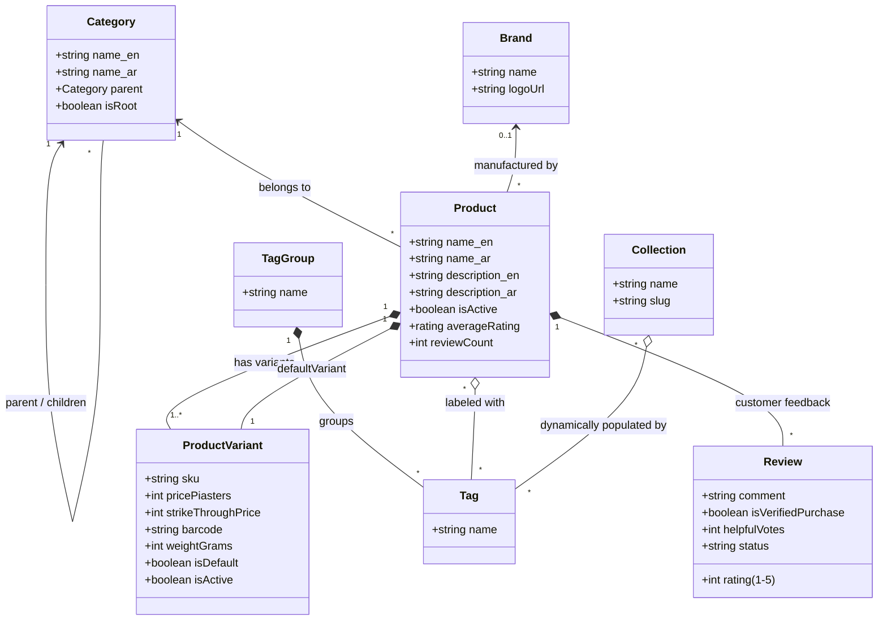
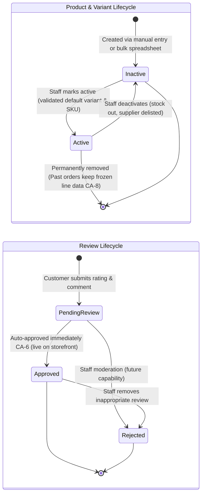

# Catalog & Merchandising

As of 2026-10-11 · Clarity: **Launch scope decided; model not documented**

> What the store needs for launch is decided (see Capabilities). The catalog model itself is not: those terms are **proposed**, and every rule marked _unconfirmed_ describes how the product behaves today, not what the business has decided.

## Purpose

FindEg sells stationery, plus gifts and toys. This is the core of the business, and the store's first launch waits on Staff being able to upload this catalog and its content through the dashboard. The area defines what FindEg sells and helps Customers find it: products and their variants, how they are classified and grouped, how they are presented, and what Customers say about them. The catalog also feeds School Supply Lists, because list Specifications match on its categories and attributes.

## Actors

| Actor | Role in this area |
|---|---|
| Customer | Browses, searches, filters, reads and writes reviews |
| FindEg Staff (catalog, editorial) | Maintains products, variants, categories, brands, tags, collections and media; reads search analytics |

## Terms (proposed)

**Product**: An item FindEg sells, with an English and Arabic name and descriptions, one category, an optional brand, tags and attributes. It is active or inactive.

**Product Variant**: One buyable version of a Product, such as a colour or size, with its own SKU, price, optional strike-through price, barcode, weight, images and attribute values. Customers buy variants, never products.

**Default Variant**: The variant shown first for a Product. A product has exactly one.

**Category**: A node in a strict tree used for navigation, such as Stationery › Notebooks. A Product sits in one category.

**Brand**: The manufacturer of a Product.

**Tag**: A cross-cutting label in a tag group, such as "School prep". Filters combine tags in the same group with OR and tags in different groups with AND.

**Collection**: A marketing grouping with its own page, filled by the products carrying its tags.

**Attribute**: A named, typed property such as colour or paper weight, with values on variants. Attributes drive storefront filters and School Supply List Specifications.

**Review**: A Customer's rating and comment on a Product, which can be marked as a verified purchase, and which other Customers can vote helpful.

**Media Asset**: An image stored by FindEg and used on products, collections, lists and Partner School logos.

### Content and catalog loading (decided)

**Catalog Import**: Adding or updating many products and variants at once from a spreadsheet, as opposed to entering them one by one in the dashboard. Both ways exist.

**Home Banner**: A promotional slot on the home page, managed by Staff, pointing to a product, category or collection.

**Content Page**: A fixed informational page: about, delivery, returns, privacy. _Avoid_: Blog post.

A gift guide is a Collection, not a separate concept.

### Catalog Hierarchy & Merchandising Structure

## Capabilities

| Actor | Capability | State |
|---|---|---|
| Staff | Create and edit products and variants, including prices | Built |
| Staff | Manage categories, brands, tags and collections | Built |
| Staff | Manage the media library | Built |
| Staff | View search analytics (what Customers search for) | Built |
| Customer | Browse the shop, categories and collections | Built |
| Customer | Search and filter by attributes and tags | Built |
| Customer | Read and write product reviews, vote a review helpful | Built |
| Staff | Moderate reviews before or after they appear | Proposed |
| Staff | Import products and variants in bulk from a spreadsheet | Decided (launch) |
| Staff | Add product images from supplier files and from FindEg's own photos | Decided (launch) |
| Staff | Manage Home Banners and featured sections | Decided (launch) |
| Staff | Publish collections, including gift guides | Decided (launch) |
| Staff | Publish the about, delivery, returns and privacy Content Pages | Decided (launch) |
| Staff | Publish blog articles | After launch |

## Rules (unconfirmed)

- **CA-1** _(unconfirmed)_ Every Product has at least one variant, and exactly one is the Default Variant.
- **CA-2** _(unconfirmed)_ A variant's SKU is unique across the catalog.
- **CA-3** _(unconfirmed)_ Price lives on the variant, in EGP, with an optional strike-through price and a Staff-only cost price.
- **CA-4** _(unconfirmed)_ Inactive products and variants are not sold, and an inactive variant is never an Allowed Alternative on a School Supply List.
- **CA-5** _(unconfirmed)_ A Product's name and descriptions exist in both English and Arabic.
- **CA-6** _(unconfirmed)_ A new Review appears immediately; nothing holds it for moderation.
- **CA-7** _(unconfirmed)_ A Product's rating and review count follow its Reviews.
- **CA-8** _(unconfirmed)_ Removing a product or variant never changes past Orders: Orders keep their own frozen names and prices.

## Lifecycle

## Known gaps

| # | Rule | What happens today |
|---|---|---|
| 1 | CA-3 | The dashboard product table shows prices in USD. Everything else uses EGP. |
| 2 | Product term | Inactive products are labelled "Draft" in some dashboard views and "Inactive" in others. "Draft" is a School Supply List status. |
| 3 | Review moderation | Staff moderation was planned, but reviews appear immediately and Staff have no review screen. |

## Open questions

Each item names a suggested owner. Tick it when the answer is recorded on this page.

### Before launch

- [ ] **Launch volume** (Business): About how many products and variants will the store launch with? An order of magnitude is enough.
- [ ] **Import updates** (Product): When an imported row's SKU already exists, does it update that product or is the row rejected?
  Suggested: update by SKU, so the same spreadsheet keeps the catalog current after launch.
- [ ] **Import errors** (Product): When some rows have errors, is the whole file refused or are only those rows skipped?
  Suggested: refuse the whole file with a row-by-row error report, so a half-imported catalog never goes live.
- [ ] **Image matching** (Catalog team): How does a bulk-uploaded image find its variant: SKU in the file name, a spreadsheet column, or by hand?
  Suggested: a spreadsheet column listing each variant's image files in order; by hand for one-off fixes.
- [ ] **Out of stock** (Business): Are out-of-stock products shown as unavailable, or hidden?
- [ ] **Units** (Catalog team): Are some variants sold only in packs or multiples, such as a dozen?
- [ ] **Strike-through price** (Business): Does it mean "was" (a sale) or "list price" (compare-at)? Who may set it?

### After launch

- [ ] **Product status** (Product): Is active/inactive enough, or does a product need a draft or archived state?
- [ ] **Price changes** (Business): Do price changes need approval, or a record of who changed what?
- [ ] **Reviews** (Business): Who may review: anyone, signed-in Customers, or verified buyers only? Moderate before or after publishing? Who may edit or remove a review?
- [ ] **Collections** (Marketing): Filled only by tags, or also hand-picked?
- [ ] **Search analytics** (Marketing): What decisions is it meant to support?
