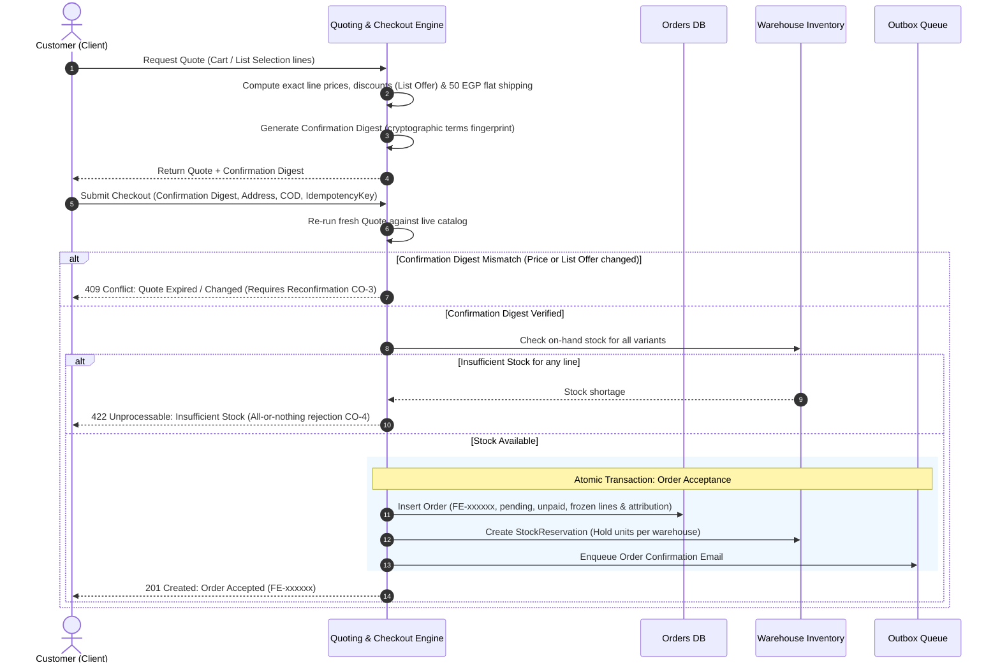

# Checkout & Orders

As of 2026-10-11 · Clarity: **Clear**

## Purpose

Turn a Cart or a List Selection into an accepted cash-on-delivery Order, at exactly the price the Customer agreed to, and take it through fulfilment while keeping stock counts true. Guests buy and track Orders as easily as signed-in Customers.

## Actors

| Actor | Role in this area |
|---|---|
| Customer (guest or signed in) | Checks out, receives emails, looks up their Order |
| FindEg Staff (operations) | Moves Orders through fulfilment, cancels, refunds, adjusts inventory, resends failed emails |
| Courier and support | Identify an Order by its Order Reference; not users of the product |

## Terms

**Cart**: The ordinary catalog items a Customer intends to buy. It never contains List Selections.

**Quote**: FindEg's authoritative pricing of a set of lines at a moment in time: unit prices, discounts, shipping and total, plus a Confirmation. Discounts are per-line entries tagged by their source. _Avoid_: Estimate, cart total.

**Confirmation**: A fingerprint of a Quote's terms that the Customer agrees to. An Order is accepted only if a fresh Quote still produces the same Confirmation. _Avoid_: Price token, checksum.

**List Offer**: A percentage discount on one School Supply List, active for a time window, applied to every line bought from that list. _Avoid_: List discount, coupon, promotion.

**Order Acceptance**: The single all-or-nothing moment an Order comes into existence: re-priced, stock reserved, prices and attribution frozen. It is not an Order Status. _Avoid_: Order placement, order creation, confirmed order.

**Order**: A Customer's accepted purchase, from either the Cart or exactly one School Supply List. An Order from a list is also an Attributed Order (see [Partners](partners.md)).

**Order Reference**: The short, public, readable identifier of an Order: `FE-` plus 6 characters. It is not a secret. _Avoid_: Order number, order id, tracking code.

**Order Status**: Where an Order is in fulfilment: pending, confirmed, processing, shipped, delivered, cancelled or refunded. **Confirmed** means Staff phoned the Customer and the Customer confirmed the cash-on-delivery Order; it is not Order Acceptance.

**Payment Status**: Whether the Order's money has been collected: unpaid, paid or refunded. It is separate from Order Status and has no stock effect.

**Stock Reservation**: Units held for an accepted Order at a specific warehouse, from Order Acceptance until they are consumed at delivery or released by Cancellation. _Avoid_: Allocation, hold.

**Cancellation**: Stopping an Order before delivery, including a parcel refused at the door or returned. It releases the Stock Reservation. _Avoid_: Refund (before delivery), void.

**Refund**: Returning a Customer's money after delivery. It has no stock effect; returned goods are restocked by a manual inventory adjustment. _Avoid_: Cancellation, return.

**Guest Order Access**: How a Customer without an account views an Order: they give its Order Reference and email, and prove it with a one-time code emailed on request. _Avoid_: Order tracking, guest login.

### Quoting & Atomic Order Acceptance Sequence



## Capabilities

| Actor | Capability | State |
|---|---|---|
| Customer | Check out the Cart, as a guest or signed in | Built |
| Customer | Check out a List Selection as its own Order | Built |
| Customer | Pay cash on delivery | Built |
| Customer | Pay by card | Not settled (needs a payment design first) |
| Customer | Be asked to reconfirm when a price, offer or shipping changed since the Quote | Built |
| Customer | Receive confirmation, shipped, delivered and cancelled emails | Built |
| Guest | Look up an Order with its reference, email and a one-time code | Built |
| Signed-in Customer | See their Orders in their account | Built |
| Staff | Move Orders through fulfilment, one at a time or in bulk | Built |
| Staff (Operations) | Phone the Customer to confirm a cash-on-delivery Order, then mark it confirmed | Decided (launch) |
| Staff | Cancel an Order, including a shipped one once the parcel is back | Built |
| Staff | Refund a delivered Order | Built |
| Staff | Adjust inventory per warehouse | Built |
| Staff | See and resend emails that failed every attempt | Decided |
| Staff | Set a List Offer | Built (see [School Supply Lists](school-supply-lists.md)) |
| Customer | Coupons, stacked discounts, delivery zones, backorders, partial acceptance | Not settled |

## Rules

- **CO-1** An Order comes from the Cart or from exactly one School Supply List, never both.
- **CO-2** FindEg prices everything. Prices sent from the Customer's device are never trusted.
- **CO-3** An Order is accepted only if a fresh Quote produces the same Confirmation the Customer agreed to. Otherwise the Customer must reconfirm. A List Offer that starts, changes or ends in between counts as a change.
- **CO-4** Order Acceptance is all or nothing: re-price, reserve stock and freeze prices and attribution in one step. Not enough stock rejects the whole Order. There is no partial acceptance and no backorder.
- **CO-5** Retrying the same checkout never creates a second Order: it returns the original. A retry that changes the request is rejected.
- **CO-6** Phase one accepts cash on delivery only.
- **CO-7** Shipping is one flat fee (50 EGP by default), with no delivery zones.
- **CO-8** The List Offer is the only discount. It applies to every line of the list's Order, including substitutes, and each line is rounded half-up to a piaster.
- **CO-9** Money is EGP, counted exactly in piasters.
- **CO-10** An accepted Order's prices, discounts, shipping and attribution never change, and Orders and their lines are never deleted.
- **CO-11** Stock is reserved at acceptance, consumed when the Order is delivered and released when it is cancelled. A Refund changes no stock.
- **CO-12** Order Status moves only along: pending → confirmed or cancelled; confirmed → processing or cancelled; processing → shipped or cancelled; shipped → delivered or cancelled; delivered → refunded. Cancelled and refunded are final, and nothing returns to pending.
- **CO-13** A Refund follows only delivery. Stopping an Order before delivery is always a Cancellation. A shipped Order is cancelled only when the parcel is back in the warehouse.
- **CO-14** Every Order has an Order Reference. Knowing it alone grants nothing.
- **CO-15** Guest Order Access: the lookup always answers the same way, so it never reveals whether an Order exists. A code is valid for 15 minutes and 5 tries, and an Order allows 3 code requests per hour.
- **CO-16** Order emails are sent only after the change is saved, and are retried until delivered: the confirmation at acceptance, and shipped, delivered and cancelled at most once each.
- **CO-17** Business Partner Status never affects checkout, acceptance or fulfilment.
- **CO-18** An Order becomes confirmed only after Staff have phoned the Customer and the Customer confirmed it.

## Lifecycle

### Synchronized Order, Payment & Stock State Lifecycle

```mermaid
stateDiagram-v2
    direction TB

    state "Pending (Unpaid)" as pending {
        [*] --> Pending_Active
        note right of Pending_Active: Stock: RESERVED\nPayment: UNPAID\nAttribution: FROZEN
    }

    state "Confirmed (Unpaid)" as confirmed {
        note right of confirmed: Confirmed via phone CO-18\nStock: RESERVED\nPayment: UNPAID
    }

    state "Processing (Unpaid)" as processing {
        note right of processing: Warehouse pick & pack\nStock: RESERVED\nPayment: UNPAID
    }

    state "Shipped (Unpaid)" as shipped {
        note right of shipped: In transit with courier\nStock: RESERVED\nPayment: UNPAID
    }

    state "Delivered (Paid)" as delivered {
        note right of delivered: Courier collects COD cash\nStock: CONSUMED CO-11\nPayment: PAID
    }

    state "Cancelled (Terminal)" as cancelled {
        note right of cancelled: Cancelled before delivery\nStock: RELEASED CO-11\nPayment: UNPAID
    }

    state "Refunded (Terminal)" as refunded {
        note right of refunded: Follows delivery only CO-13\nStock: UNCHANGED (Manual restock)\nPayment: REFUNDED
    }

    [*] --> pending: Order Acceptance (Atomic)
    pending --> confirmed: Customer confirmed by phone
    pending --> cancelled: Customer unreachable / cancelled
    confirmed --> processing: Dispatched to warehouse
    confirmed --> cancelled: Cancelled before packing
    processing --> shipped: Handover to courier
    processing --> cancelled: Cancelled before dispatch
    shipped --> delivered: Delivered & cash collected
    shipped --> cancelled: Parcel back in warehouse CO-13
    delivered --> refunded: Approved return after delivery
    cancelled --> [*]
    refunded --> [*]
```

## Known gaps

| # | Rule | What happens today |
|---|---|---|
| 1 | CO-6 | **Launch blocker.** Card still appears as a payment option at checkout, but it cannot be paid. |
| 2 | CO-7 | **Launch blocker.** Checkout shows 30 EGP shipping for card and 50 for cash on delivery, while the Order is always charged the flat fee. |
| 3 | Order Status term | Order emails can show a "returned" status that does not exist. |

## Open questions

Each item names a suggested owner. Tick it when the answer is recorded on this page.

### Before launch

- [ ] **Unreachable Customer** (Operations): How many call attempts, over how long, before an unconfirmed Order is cancelled?
  Suggested: three attempts within 48 hours, then cancel with the reason "Customer unreachable".
- [ ] **Phone number** (Product): Is a phone number required at checkout for every Customer? Confirmation by phone (CO-18) needs one.
  Suggested: required.
- [ ] **"Returned" in emails** (Product): Is removing the non-existent "returned" status from Order emails a launch blocker?
  Suggested: yes; Customers would see a status FindEg never uses.
- [ ] **Delivery coverage** (Operations): Which governorates does FindEg deliver to at launch, with what delivery-time promise, and through which courier?
- [ ] **Shipping fee** (Business): Is 50 EGP the launch flat fee? Is there a free-shipping threshold or a minimum order value?
- [ ] **VAT and receipts** (Finance): Do prices include VAT, and what must the Order confirmation show?
- [ ] **Returns policy** (Business, Legal): Within how many days can a delivered Order be returned, for which reasons, and who pays return shipping? The returns Content Page and Refunds depend on it.
- [ ] **Customer cancellation** (Business): Can a Customer cancel their own Order before it ships, or only by contacting FindEg?
- [ ] **Cash collection** (Finance, Operations): Who marks an Order paid once the courier collects the cash, and how is courier cash reconciled?
- [ ] **Returned parcels** (Operations): Is "cancel a shipped Order only once the parcel is back" checked by the product, or a Staff instruction?

### After launch

- [ ] **Card payment** (Business, Product): When card returns, what shape does a payment option take, and how does it change the Quote?
- [ ] **Refund and payment** (Finance): Should a Refund always set the Payment Status to refunded?
