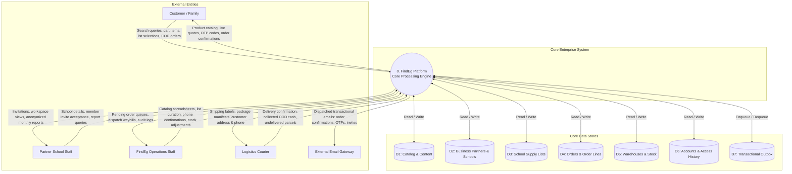
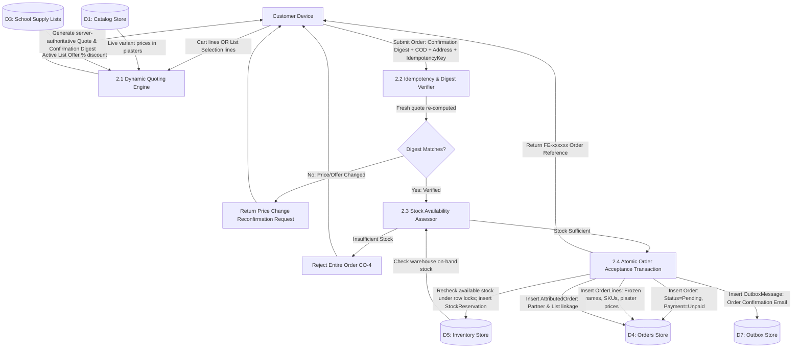
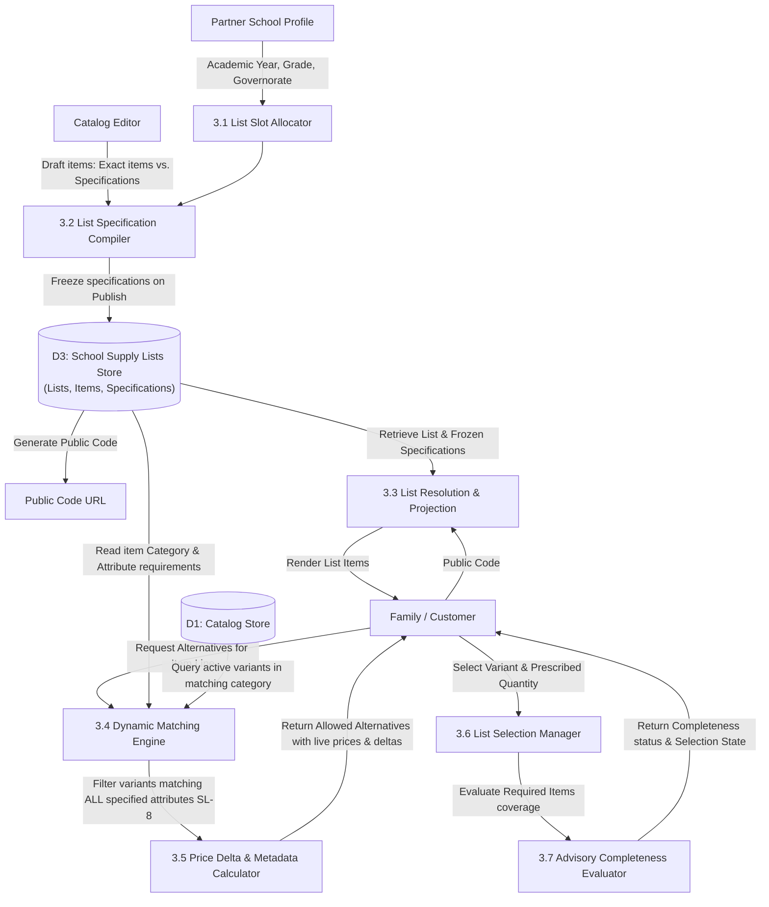
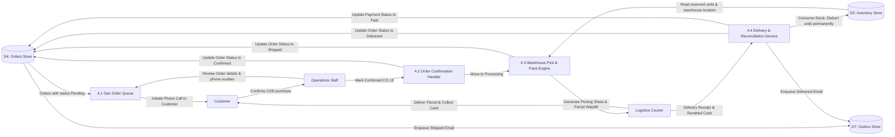
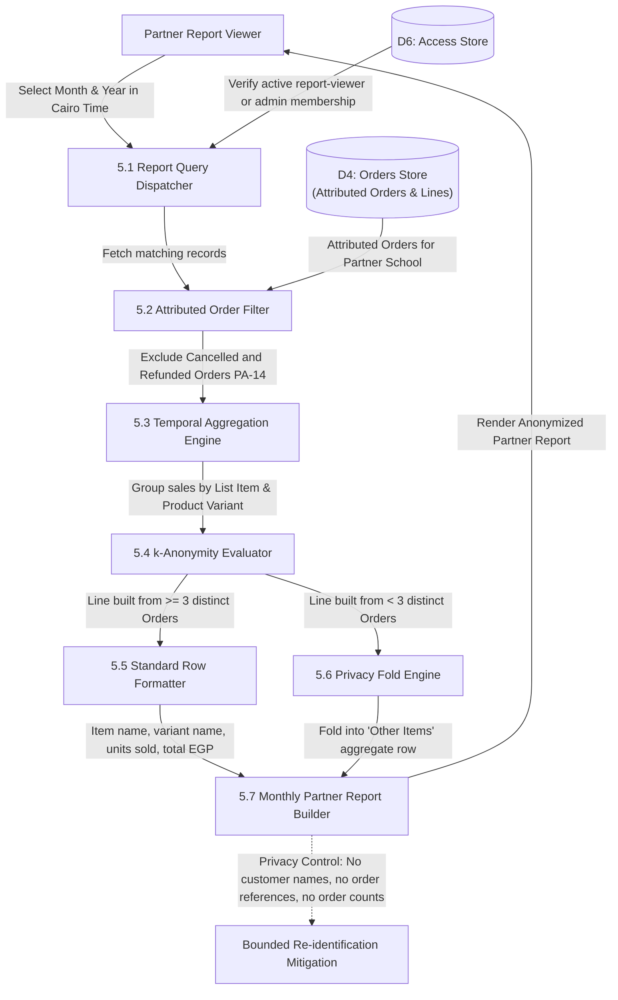
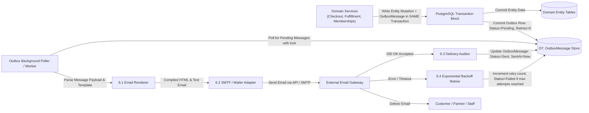

# Enterprise Data Flow Diagrams (DFD)

As of 2026-10-12 · Clarity: **Enterprise Information Architecture & Data Flows**

This document details the data transformations, persistent storage interactions, and external data exchanges across FindEg using standard Data Flow Diagram conventions (Level 0 Context and Level 1 Sub-Systems).

---

## 1. DFD Level 0: Macro Context Data Flow

The macro-level boundary between external entities and FindEg's platform data stores.

---

## 2. DFD Level 1 Sub-System Diagrams

### 2.1. DFD Level 1: Catalog & Merchandising Ingestion

Data flow for product catalog creation, validation, media linking, and storefront search/browse indexing.

```mermaid
flowchart LR
    Staff["Catalog & Content Editor"] -->|Spreadsheet / Manual Entry| P1_1["1.1 Ingestion & Schema Validation"]
    P1_1 -->|Valid bilingual data, SKUs & Piaster prices| P1_2["1.2 Product & Variant Creator"]
    P1_1 -->|Validation errors| Staff

    MediaService["Media Library"] -->|Image URLs & CDN keys| P1_2
    P1_2 -->|Write Products & Variants| D_Catalog[("D1: Catalog Store<br/>(Products, Variants, Categories, Attributes, Tags)")]

    D_Catalog -->|Read categories & tags| P1_3["1.3 Taxonomy & Hierarchy Engine"]
    P1_3 -->|Build Category Tree & Tag Groups| P1_4["1.4 Merchandising & Collection Builder"]
    Staff -->|Home Banners & Featured Collections| P1_4

    P1_4 -->|Published Storefront Index| D_SearchIndex[("D1.1: Storefront Search & Filter Cache")]
    Customer["Storefront Customer"] -->|Search keywords & attribute filters| P1_5["1.5 Discovery & Browse Engine"]
    D_SearchIndex -->|Query matches| P1_5
    P1_5 -->|Product listings, variants, prices| Customer

    Customer -->|Submit review & rating| P1_6["1.6 Review Processor"]
    P1_6 -->|Write verified review & recalc ratings| D_Catalog
```

---

### 2.2. DFD Level 1: Dynamic Quoting, Order Acceptance & Inventory Reservation

The transactional data flow from Cart/List Selection to an accepted Order with immutable attribution and held inventory.

---

### 2.3. DFD Level 1: School Supply List Dynamic Matching & Alternative Resolution

The runtime evaluation pipeline that matches live catalog variants against school specifications.

---

### 2.4. DFD Level 1: Operations, Fulfillment & Cash Settlement

How orders move through physical picking, phone confirmation, courier dispatch, and COD reconciliation.

---

### 2.5. DFD Level 1: Privacy-Preserving Partner Reporting Pipeline

The aggregation pipeline that calculates monthly sales totals for school bursars while strictly preventing individual customer or order re-identification.

---

### 2.6. DFD Level 1: Transactional Outbox & Notification Pipeline

The reliable communication pipeline ensuring transactional integrity between database mutations and asynchronous email delivery.

