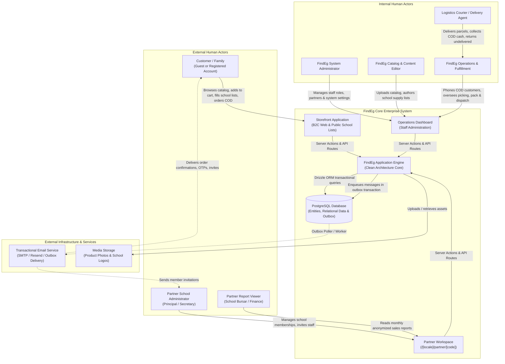
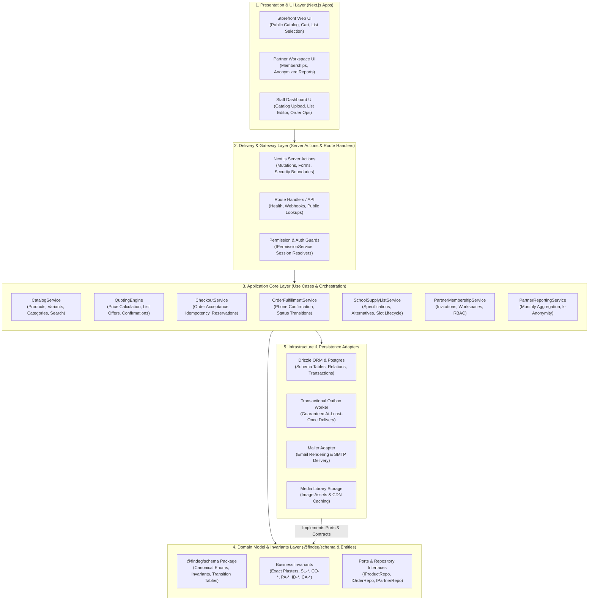
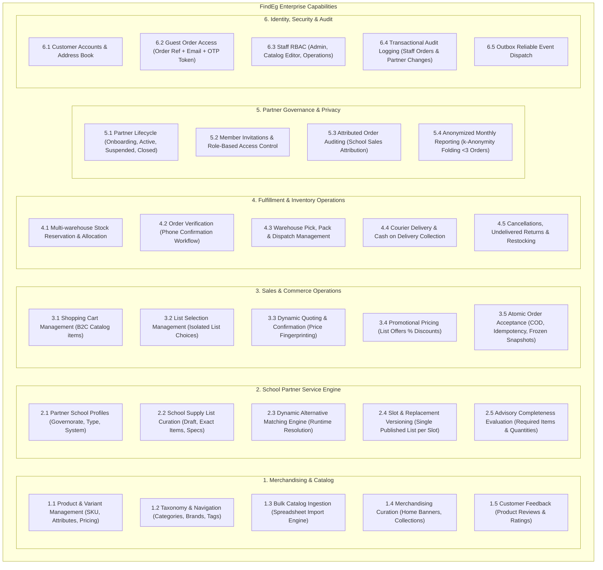
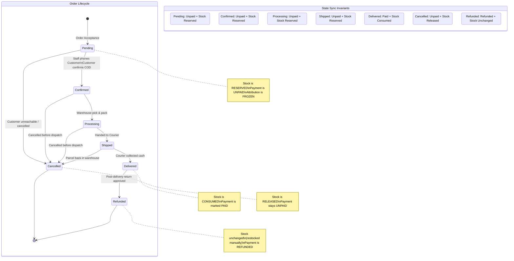

# Enterprise System Architecture

As of 2026-10-12 · Clarity: **Enterprise Architectural Blueprint**

This document provides the macro-level architectural views and structural models for FindEg, establishing standard enterprise blueprints across business capabilities, system layers, bounded contexts, and governance frameworks.

---

## 1. System & Ecosystem Context (C4 Level 1)

FindEg operates a dual-engine retail and B2B2C ecosystem in Egypt: a core direct-to-consumer (B2C) stationery and gifts e-commerce platform, and a B2B2C Partner Program with schools as the foundation.

---

## 2. Multi-Tier Layered System Architecture

FindEg is built upon strict **Clean Architecture** and package boundaries. Dependencies flow strictly inwards toward the Domain Core.

---

## 3. Business Capability Model

Functional decomposition of FindEg's business capabilities into Level 1 and Level 2 domains.

---

## 4. Domain-Driven Design (DDD) Bounded Context Map

Relationships and boundaries between FindEg's 7 core bounded contexts. Following **ADR-0016**, all cross-boundary relationships are linked strictly by identifiers (`id` or `orderReference`), never by object references.

```mermaid
flowchart LR
    subgraph BC_Catalog["Catalog Bounded Context"]
        ProductVariant["ProductVariant<br/>(SKU, price in piasters, attributes)"]
        Product["Product"]
        Category["Category (Tree)"]
    end

    subgraph BC_School["School Supply List Context"]
        SchoolSupplyList["SchoolSupplyList<br/>(Draft/Published/Archived)"]
        SchoolSupplyListItem["SchoolSupplyListItem<br/>(ExactItem | Specification)"]
        ListSelection["ListSelection<br/>(Client in-progress choices)"]
    end

    subgraph BC_Partner["Business Partner Context"]
        BusinessPartner["BusinessPartner<br/>(Onboarding/Active/Suspended/Closed)"]
        PartnerSchoolProfile["PartnerSchoolProfile<br/>(Governorate, system, logo)"]
        PartnerMembership["PartnerMembership<br/>(Active/Suspended/Ended)"]
        PartnerReport["PartnerReport<br/>(Aggregated monthly totals)"]
    end

    subgraph BC_Sales["Sales & Orders Context"]
        Order["Order<br/>(Reference: FE-xxxxxx)"]
        OrderLine["OrderLine<br/>(Frozen SKU, name, price)"]
        ListOffer["ListOffer<br/>(% discount on list)"]
        AttributedOrder["AttributedOrder<br/>(Immutable school link)"]
        GuestOrderAccess["GuestOrderAccess<br/>(15-min OTP token)"]
    end

    subgraph BC_Customer["Customer & Identity Context"]
        Customer["Customer<br/>(Account profile, addresses)"]
        StaffAccount["Staff Account<br/>(Staff Roles & Permissions)"]
    end

    subgraph BC_Inventory["Inventory Bounded Context"]
        StockReservation["StockReservation<br/>(Units held per warehouse)"]
        Warehouse["Warehouse"]
    end

    subgraph BC_System["System & Outbox Context"]
        OutboxMessage["OutboxMessage<br/>(Pending/Sent/Failed events)"]
    end

    BC_School -- "references variantId" --> BC_Catalog
    BC_School -- "references businessPartnerId" --> BC_Partner

    BC_Sales -- "references customerId" --> BC_Customer
    BC_Sales -- "references variantId" --> BC_Catalog
    BC_Sales -- "references supplyListId" --> BC_School
    BC_Sales -- "references businessPartnerId" --> BC_Partner

    BC_Inventory -- "references orderId" --> BC_Sales
    BC_Inventory -- "references variantId" --> BC_Catalog

    BC_Partner -- "references customerId" --> BC_Customer
    BC_System -- "payload.orderId" --> BC_Sales
```

---

## 5. Unified Enterprise State Coordination Engine

A critical enterprise architectural invariant at FindEg is the strict coordination between **Order Status**, **Payment Status**, and **Stock Reservation Lifecycle**.

---

## 6. Enterprise Security & Role-Based Access Control (RBAC) Matrix

FindEg enforces absolute separation between Customer Accounts, Staff Dashboard Roles, and Partner Workspace Roles (**ID-1**, **ID-2**, **PA-4**).

| Access Domain | Identity / Role | Accessible Surface | Primary Capabilities & Boundaries |
|---|---|---|---|
| **Public** | Guest (No Account) | Storefront | Browse catalog, build Cart/List Selection, checkout COD, look up order via `GuestOrderAccess` OTP. |
| **Customer** | Signed-in Customer | Storefront (`/account`) | Manage profile, view personal order history, save addresses. Has **no** access to Staff dashboard or Partner Workspaces without distinct role assignment. |
| **Partner** | `partner-administrator` | Partner Workspace (`/partner/[code]`) | Invite members (7-day link), manage member roles, suspend/reactivate members, read monthly `PartnerReport`. Always at least 1 per partner. |
| **Partner** | `report-viewer` | Partner Workspace (`/partner/[code]`) | Read-only access to anonymized monthly `PartnerReport` (k-anonymity applied). Cannot manage members. |
| **Partner** | `list-manager` / `collection-staff` | Partner Workspace (`/partner/[code]`) | Granted roles reserved for future partner self-service; grant no operational privileges today. |
| **Staff** | `Administrator` | Dashboard (`/dashboard`) | Full access: manage Staff accounts, grant Staff roles, create & onboard Business Partners, view audit logs. |
| **Staff** | `Catalog & Content Editor` | Dashboard (`/dashboard`) | Manage products, variants, prices, images, categories, brands, tags, Home Banners, Content Pages, School Supply Lists. |
| **Staff** | `Operations` | Dashboard (`/dashboard`) | View orders, perform COD phone confirmation, move orders through fulfillment (`processing`, `shipped`, `delivered`), cancel orders, trigger refunds, adjust inventory. |
