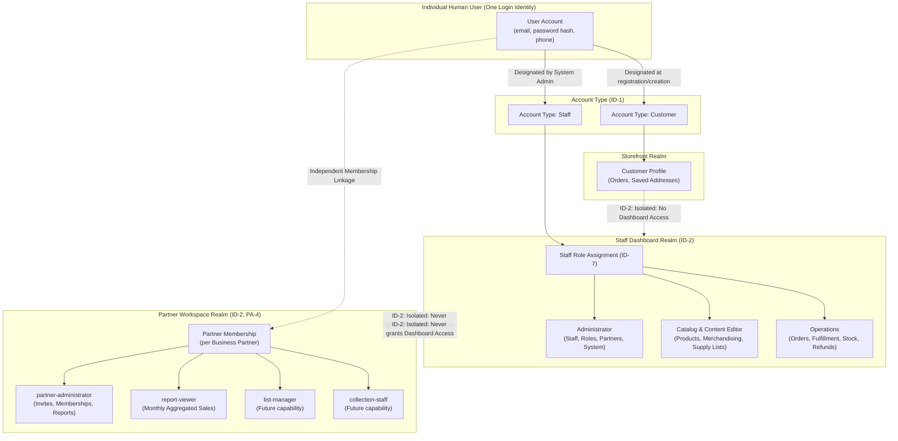
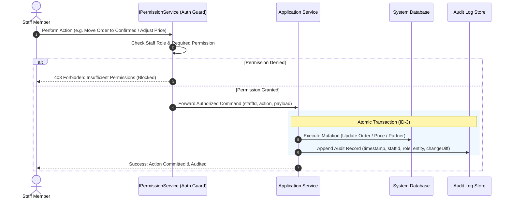

# Identity & Administration

As of 2026-10-11 · Clarity: **Launch roles decided; rest not documented**

> **Customer**, **Staff** and **Staff Role** are decided. The other terms are **proposed**, and rules marked _unconfirmed_ describe how the product behaves today without a business decision.

## Purpose

Know who is acting and what they are allowed to do: Customers who shop with or without an account, and FindEg Staff who run the business from the dashboard, each limited to their job and recorded when they change something important. Partner access is a separate model, described in [Partners](partners.md).

## Actors

| Actor | Role in this area |
|---|---|
| Guest | Shops and checks out without an account |
| Customer with an account | Registers, signs in, manages profile and addresses, sees their Orders |
| FindEg Staff | Signs in to the dashboard and works within their Staff Role |
| System administrator | Manages Staff accounts and roles |

## Terms

**Customer** _(decided)_: A person who shops on the storefront, whether browsing in general or filling a School Supply List. _Avoid_: Parent, buyer, account.

**Guest** _(proposed)_: A Customer without an account. They can buy, and look up their Orders through Guest Order Access (see [Checkout & Orders](checkout-and-orders.md)).

**Account** _(proposed)_: A person's sign-in identity: email, name, phone and Account Type. One person has one account, whatever Partner Memberships they hold.

**Account Type** _(proposed)_: Whether an account is a Customer account or a Staff account. It never grants partner access.

**Staff** _(decided)_: A FindEg employee with a Staff account who works in the dashboard.

**Staff Role** _(decided)_: A named responsibility given to Staff, which decides what they may do in the dashboard. Three exist at launch:

| Staff Role | Responsible for |
|---|---|
| Administrator | Everything, including Staff accounts and their roles |
| Catalog & Content Editor | Products, variants, prices, images, categories, brands, collections, Home Banners, Content Pages |
| Operations | Orders, fulfilment, cancellations, refunds, inventory |

Other roles (customer support, business analyst, and so on) are added only when someone needs them. _Avoid_: Partner Role.

**Permission** _(proposed)_: One thing a Staff Role allows, such as writing School Supply Lists, managing partners or viewing partner reports.

**Address** _(proposed)_: A delivery address saved on a Customer's account.

**Audit Log** _(proposed)_: The record of important Staff changes: who changed what, and when.

### Identity Boundaries & RBAC Separation Architecture

## Capabilities

| Actor | Capability | State |
|---|---|---|
| Guest | Buy and look up Orders without an account | Built |
| Customer | Register and sign in on the storefront | Built |
| Customer | See their Orders and edit account settings | Built |
| Staff | Sign in to the dashboard and see only the sections their role allows | Built |
| System administrator | Manage Staff accounts | Built |
| Staff | Read the Audit Log | Built |
| Staff | Read in-dashboard notifications | Built |
| Customer | Reset a forgotten password, verify email or phone, delete their account | Not known |

## Rules

- **ID-1** An account is either a Customer account or a Staff account. Partner access never comes from the account type.
- **ID-2** Partner access and Staff access are separate: a Staff Role never grants Partner Workspace access, and a Partner Role never grants dashboard access.
- **ID-3** Every Staff change to an Order checks the Staff member's permission and records who did it, in the same step as the change.
- **ID-4** Deleting an account never deletes that person's Orders, and is refused while they hold a Partner Membership.
- **ID-5** _(unconfirmed)_ A Staff member's dashboard shows only the sections their permissions allow.
- **ID-6** _(unconfirmed)_ FindEg never keeps a readable copy of a password.
- **ID-7** At launch, every Staff member holds at least one of the three Staff Roles, and only an Administrator manages Staff accounts and roles.

## Lifecycle & Governance

### Staff Action Guard & Audit Trail Flow (ID-3)

## Known gaps

| # | Rule | What happens today |
|---|---|---|
| 1 | ID-1 | The Customer account area contains a leftover admin-style section with Products, Customers and Team screens and permission actions, reachable by any signed-in account. It shows only that account's own Orders and public products. |

## Open questions

Each item names a suggested owner. Tick it when the answer is recorded on this page.

### Before launch

- [ ] **Leftover admin section** (Product): Remove the admin-style section from the Customer account area?
  Suggested: yes, before launch.
- [ ] **Password recovery and verification** (Product): How do Customers recover a password? Must email or phone be verified before buying?
  Suggested: password reset by email at launch; no verification before buying, since the confirmation call covers cash on delivery.
- [ ] **Audit Log scope** (Business): Which Staff changes are recorded: Orders only, or also prices, products and Staff accounts?
  Suggested: Orders, prices and Staff accounts at launch.
- [ ] **Account deletion and data** (Legal): Can a Customer delete their account, and what happens to their data? The privacy Content Page must state it.
- [ ] **Staff who shop** (Business): Can one person be both Staff and a Customer, or does a Staff member shop with a separate account?

### School milestone

- [ ] **Roles for the school milestone** (Business): Which Staff Role manages School Supply Lists, List Offers and Business Partners?
  Suggested: the Catalog & Content Editor manages lists and List Offers, since Specifications need catalog knowledge; only an Administrator manages partners and their members.
