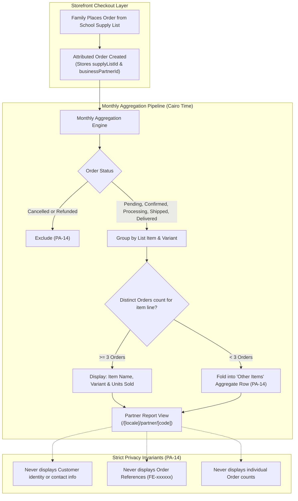
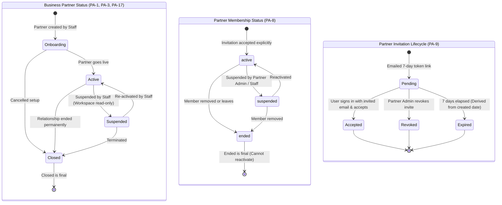

# Partners

As of 2026-10-12 · Clarity: **Clear, except money**

## Purpose

This area is the Partner Program (B2B2C): FindEg serves the biggest business customers in the stationery market by making buying easier between them and their own clients, who are Customers. Schools are the first Partner Segment, and other segments wait until schools are stable. The program is defined by its service to both sides; the money relationship between FindEg and a partner is not settled. This area covers who a partner is, where the relationship stands, which of the partner's people can work in its Partner Workspace and with what responsibilities, and what sales the partner can see from its lists, without ever exposing a Customer.

## Actors

| Actor | Role in this area |
|---|---|
| FindEg Staff | Create partners, change their status, invite and manage members on a partner's behalf, read full reports |
| Partner Administrator | Invites people and manages memberships for their partner |
| Report viewer | Reads the partner's Partner Report (for example a school bursar) |
| List manager, collection staff | Roles that can be held but grant nothing today |
| Invitee | Accepts or ignores a Partner Invitation |

## Terms

**Partner Program**: FindEg's B2B2C extension: services that make buying easier between a business customer and its own clients. _Avoid_: B2B, affiliate program, referral program.

**Partner Segment**: A kind of Business Partner the Partner Program serves. Schools are the first and only segment today.

**Partner Service**: What FindEg offers one Partner Segment. The School Supply List is the schools' Partner Service: the school prepares one list, and families get it delivered in one click.

**Business Partner**: An organization FindEg has a commercial relationship with. A Partner School (see [School Supply Lists](school-supply-lists.md)) is one kind. _Avoid_: Partner on its own.

**Business Partner Status**: Where the relationship stands: **Onboarding** (being set up), **Active** (live), **Suspended** (paused by Staff, reversible) or **Closed** (ended, final). It governs only the partner's own access, never Customers, lists or Orders. _Avoid_: Partner state, enabled/disabled.

**Partner Code**: The partner's short code used in its Workspace web address. It can change only while the partner is onboarding, so links never break after go-live.

**Partner Membership**: A person's standing inside one Business Partner: the Partner Roles they hold and whether the membership is active, suspended or ended. It never changes the person's account type, so one person can be a Customer and a Partner Administrator. _Avoid_: Partner account, partner login.

**Partner Role**: One of four fixed responsibilities, several of which can be held at once: partner administrator, list manager, collection staff, report viewer. _Avoid_: Permission, Staff Role.

**Partner Administrator**: A member with the partner administrator role: the only role that manages invitations and memberships. _Avoid_: Partner admin, owner.

**Partner Invitation**: An emailed offer, valid 7 days from when it was last sent, to join a Business Partner with specific Partner Roles. Opening its link never accepts it. _Avoid_: Invite link, signup link.

**Partner Workspace**: The area of the FindEg website where members work for their partner. _Avoid_: Partner portal, partner dashboard.

**Partner Access History**: The permanent record of changes to a partner and its invitations and memberships: who did what, when.

**Attributed Order**: An Order placed from a School Supply List, recording that list, its Public Code and its Partner School. It is the only link between a Business Partner and Orders. _Avoid_: Partner order, referral, commission order.

**Partner Report**: What a partner's members see of the sales from its lists: quantities and amounts per month, list, item and variant. It never identifies a Customer or an Order, and never counts Orders. _Avoid_: Dashboard, analytics, statement.

### Partner Sales Attribution & Privacy-Preserving Reporting Architecture

## Capabilities

| Actor | Capability | State |
|---|---|---|
| Staff | Create a Business Partner (starts onboarding), rename it, change its code while onboarding | Built |
| Staff | Change a partner's status | Built |
| Staff, Partner Administrator | Invite someone with roles, resend, revoke | Built |
| Invitee | Sign in with the invited email and explicitly accept | Built |
| Staff, Partner Administrator | Change a member's roles; suspend, reactivate or end a membership | Built |
| Member | Leave a partner | Built |
| Partner Administrator, report viewer | Read the monthly Partner Report | Built |
| Staff | Read a partner's Attributed Orders and its full report | Partly built: no Staff screen |
| List manager | Work on lists in the Workspace | Out of scope (Staff author lists) |
| Anyone | Partner rewards, rates, balances, payouts | Not settled |
| Partner School | Buy from FindEg for its own use (bulk orders, invoices) | Out of scope: not part of the Partner Program |

## Rules

- **PA-1** A Business Partner starts onboarding. Closed is final.
- **PA-2** The Partner Code can change only while the partner is onboarding.
- **PA-3** Business Partner Status limits only the partner's own access, by the partner action table:

  | Status | Workspace | Membership changes | Reports |
  |---|---|---|---|
  | Onboarding | yes | yes | yes |
  | Active | yes | yes | yes |
  | Suspended | read-only, with notice | no | yes |
  | Closed | no | no | yes |

  Staff list authoring is a separate rule, SL-13 in [School Supply Lists](school-supply-lists.md). Closing a partner changes none of its lists; Staff archive them deliberately.
- **PA-4** Partner Membership is per Business Partner, never changes the person's account type, and is separate from Staff access.
- **PA-5** There are exactly four Partner Roles, and a membership can hold several.
- **PA-6** Only Partner Administrators, and Staff allowed to manage partners, manage invitations and memberships.
- **PA-7** A partner that is not closed always keeps at least one active Partner Administrator. Any change that would remove the last one is refused.
- **PA-8** A membership is active, suspended or ended. Ended is final. A person has at most one current membership per partner.
- **PA-9** An invitation lasts 7 days from when it was sent; resending restarts the 7 days, even for an invitation that had expired. It is expired from the moment its 7 days end. A partner has at most one pending invitation per email. Opening the link never accepts it: the invitee signs in with the invited email and accepts explicitly. Resending keeps earlier links valid. Invitation links are secret, and FindEg never keeps a readable copy of them.
- **PA-10** People who are not members see a Partner Workspace as not found.
- **PA-11** An edit based on an out-of-date view of a membership is refused.
- **PA-12** Every partner, invitation and membership change is recorded in the Partner Access History, which can never be edited or deleted. Report reads are not recorded.
- **PA-13** Only Partner Administrators and report viewers read the Partner Report, with an active membership, in every partner status.
- **PA-14** The Partner Report shows sales with one row per month, list, item and variant, with months in Cairo time. It never shows a Customer, an Order Reference or an Order count. Each row built from fewer than 3 distinct Orders is folded into "Other items", so totals still add up. Only Live Orders count: cancelled and refunded Orders are left out. Before a partner's first Order, only the current month can be read.
- **PA-15** Attributed Orders are the only link between a partner and Orders. Nothing about rewards is calculated or stored when an Order is placed or changes status.
- **PA-16** A partner's clients are Customers. The Partner Program does not model who a Customer buys for, such as a student.
- **PA-17** A partner moves only: onboarding → active or closed; active → suspended or closed; suspended → active or closed. An active partner never returns to onboarding. Activating a partner needs an active Partner Administrator, and asking for the status a partner already has is refused.
- **PA-18** The Partner School directory lists a Partner School only when it has at least one published list, whatever its status: onboarding, active, suspended and closed partners are listed alike (ADR-0012). To take a closed partner out of the directory, Staff archive its lists.

## Lifecycle

## Known gaps

| # | Rule | What happens today |
|---|---|---|
| 1 | PA-8 | The Workspace members list offers Reactivate for any member who is not active, and shows ended memberships as "Suspended", although an ended membership can never be reactivated. |
| 2 | PA-18 | The directory also lists Partner Schools with no published list unless the caller asks for listed schools only. |

## Open questions

Each item names a suggested owner. Tick it when the answer is recorded on this page. None of these block the store launch.

- [ ] **Money** (Business): Does a partner pay FindEg, earn from its Customers' purchases, or neither?
- [ ] **Signing up a school** (Business): How does a school join: only through FindEg Staff, or can a school apply on its own?
  Suggested: Staff-led only for the first segment.
- [ ] **Next segment** (Business): When are schools "stable" enough to start the next Partner Segment, and how is that measured?
- [ ] **Collection staff role** (Business): What is the collection staff role for? It can be held but grants nothing.
- [x] **Partner status changes** (Business): Is PA-17 the intended set of partner status changes?
  Answered 2026-10-12: yes, and activation needs an active Partner Administrator.
- [ ] **Attributed Orders screen** (Business): Does Staff need a screen for a partner's Attributed Orders before money is settled?
