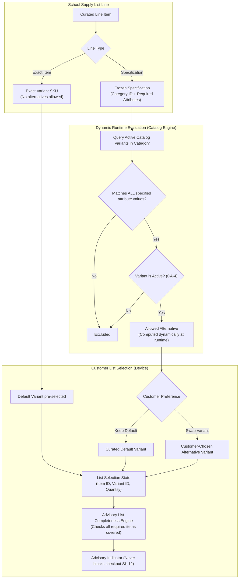
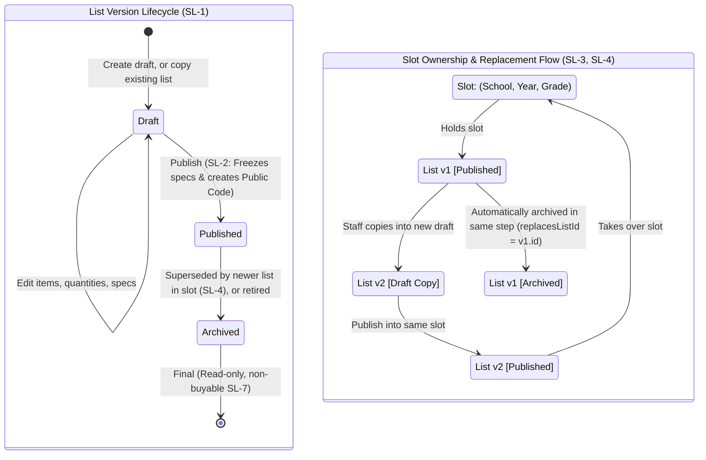

# School Supply Lists

As of 2026-10-11 · Clarity: **Clear**

## Purpose

The School Supply List is the Partner Service for schools, the first Partner Segment of the Partner Program. The promise: the school prepares one list, and families get it delivered in one click. FindEg Staff turn the school's list into a School Supply List, and any Customer with the list's link fills it in one place, chooses allowed substitutes, and buys it as its own Order from the FindEg catalog. It does not block the store's first launch.

## Actors

| Actor | Role in this area |
|---|---|
| Customer (guest or signed in) | Finds a Partner School, opens its list by link, builds a List Selection, checks it out |
| FindEg Staff | Authors every list and every Partner School Profile, sets the List Offer, archives lists |
| Partner School | Hands its list to FindEg outside the product; has no authoring surface |

## Terms

**Partner School**: A Business Partner (see [Partners](partners.md)) that is a school: the organization a School Supply List is published for. A Business Partner becomes a Partner School when it gets a Partner School Profile, and stays one. _Avoid_: School.

**Partner School Profile**: The school details shown in the Partner School directory: governorate, area, school type, academic system and logo. Maintained by FindEg Staff. _Avoid_: School profile, school record.

**School Supply List**: A curated list of items a Partner School asks its Customers to buy, moving through Draft, Published and Archived. Customers reach it through its Public Code, not a login. _Avoid_: School List, Parent List.

**School Supply List Item**: One line of a list: either an Exact Item or a Specification a Customer's choice must satisfy. Each item is required or optional and has a prescribed quantity and a default variant. _Avoid_: School List Item.

**Exact Item**: A list item that names one product variant with no substitution allowed.

**Specification**: What a non-exact list item asks for: a category plus attribute values. It is frozen when the list is published.

**Allowed Alternative**: Any product variant that matches an item's Specification, computed when the Customer chooses, never pre-picked by Staff. _Avoid_: Curated alternative.

**Slot**: The place a published list occupies: one Partner School, one academic year, one grade. A slot holds at most one published list.

**Public Code**: The long, unguessable code in a list's link. Each published version gets its own code. Holding it is the only way to reach the list.

**List Replacement**: A newly published list that takes over its source's slot. The source becomes Archived: still viewable, never buyable. A copy published into another slot replaces nothing.

**List Selection**: A Customer's in-progress choices for one published list (a variant and quantity per item), kept on their device, apart from the Cart and every other list, and checked out as its own Order. _Avoid_: Cart, list cart, kit.

**List Completeness**: Whether a List Selection covers every required item at its prescribed quantity, with any allowed substitute counting. Advisory only. _Avoid_: List validation, list progress.

The List Offer (a list's percentage discount) is defined in [Checkout & Orders](checkout-and-orders.md).

### Specification Matching & Dynamic Substitution Engine (SL-8)

## Capabilities

| Actor | Capability | State |
|---|---|---|
| Staff | Create a draft, add, edit, reorder and remove items | Built |
| Staff | Publish a draft (stock shortages warn, never block) | Built |
| Staff | Copy a published or archived list into a new draft, then publish it as a replacement or into another slot | Built |
| Staff | Archive a published list | Built |
| Staff | Set, change or remove a list's List Offer | Built |
| Staff | Create and edit a Partner School Profile | Decided, not built |
| Customer | Browse the Partner School directory by name, governorate, school type and academic system | Built |
| Customer | Open a list by its link without signing in | Built |
| Customer | Swap a non-exact item for an Allowed Alternative, seeing price difference, brand and differing attributes | Built |
| Customer | See List Completeness on the list and at checkout | Built |
| Customer | See the active List Offer on the list page | Decided, not built |
| Customer | Check out a list as its own Order | Built |
| Partner School | Author or review lists in the Partner Workspace | Out of scope |
| Customer | Continue a selection on another device | Out of scope |
| Customer | Set a number of children to multiply quantities | Out of scope (raise quantities instead) |

## Rules

- **SL-1** A list is Draft, Published or Archived. Archived is final: to reuse an archived list, copy it.
- **SL-2** Only a Draft can be edited. Publishing freezes its items, Specifications, default variants and quantities, with no exceptions.
- **SL-3** A slot holds at most one published list.
- **SL-4** Publishing a copy into the slot its source still holds archives the source in the same step and links the two as a List Replacement. A copy published into a free slot stands alone. A copy of an older version cannot displace a newer list in its slot.
- **SL-5** Publishing is refused for an empty list or for an item whose default variant is missing, inactive or not allowed by its Specification. Out-of-stock defaults only produce a warning.
- **SL-6** Publishing creates the Public Code. Drafts are never reachable by Customers.
- **SL-7** An archived list stays readable through its old link, shows a link to its replacement if there is one, and can never be checked out.
- **SL-8** Eligibility has one definition: an Exact Item allows only its default variant; an item without a Specification allows only its default; otherwise a variant is allowed when its category matches and it has every specified attribute value. The list page and checkout use the same definition, and the Customer's device never decides it.
- **SL-9** List lines are charged the live catalog price. Publishing freezes each item's name and SKU, never its price.
- **SL-10** A List Selection belongs to one published version on one device. It never merges with the Cart or another list, and it is never carried into a replacement.
- **SL-11** A selected variant that stops being allowed is flagged "choose again", never swapped automatically. Checkout is disabled while any line is flagged.
- **SL-12** List Completeness never blocks checkout and is never stored on the Order.
- **SL-13** Business Partner Status limits authoring only: publishing or replacing needs an onboarding or active partner, drafting is refused once the partner is closed, and archiving is always allowed. Reading, selecting and buying never depend on the status.
- **SL-14** Only FindEg Staff author lists and Partner School Profiles.
- **SL-15** A Partner School Profile is never removed. Governorate, school type and academic system are required; area and logo are optional.

## Lifecycle

### List Lifecycle & Slot Replacement Chain (SL-1, SL-3, SL-4)

## Known gaps

| # | Rule | What happens today |
|---|---|---|
| 1 | List Offer | The list page never shows the active List Offer, although checkout applies the discount. |
| 2 | SL-14 | Staff have no screen to create or edit a Partner School Profile, so a new Partner School cannot be set up from the dashboard. |

## Open questions

Each item names a suggested owner. Tick it when the answer is recorded on this page. None of these block the store launch.

- [ ] **Milestone release criteria** (Business, Product): What must be true to release the school milestone?
  Suggested: both Known gaps closed and the Staff Role question settled (see [Identity & Administration](identity-and-administration.md)).
- [ ] **First schools and timing** (Business): Which schools and which academic year does the milestone launch with? Back-to-school timing sets the deadline.
- [ ] **Governorates** (Business): Is the 16-governorate list intentionally partial? Egypt has 27.
- [ ] **"Verified School"** (Business): What does the label promise, and is a verification step planned?
- [ ] **Deactivated default variant** (Business): What happens to a published list whose default variant is deactivated? The list is frozen, so that item can no longer be bought as specified.
- [ ] **Partner view of lists** (Business): Should a Partner School see its own published lists, read-only, in its Partner Workspace?
