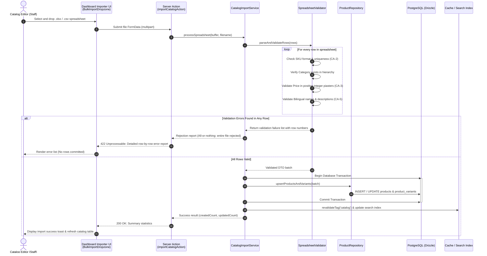
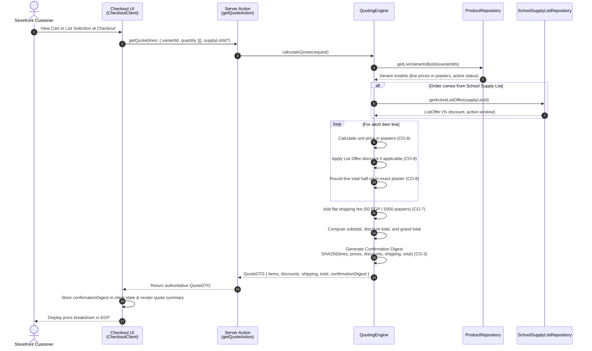
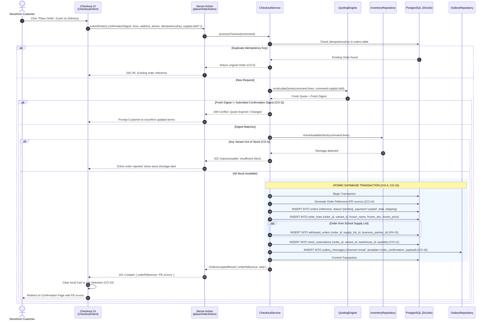
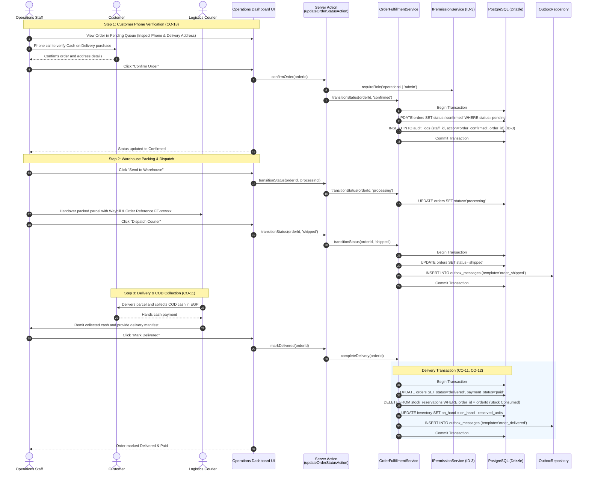
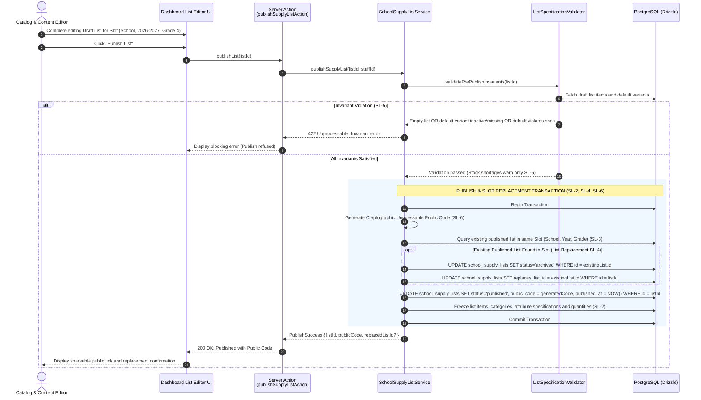
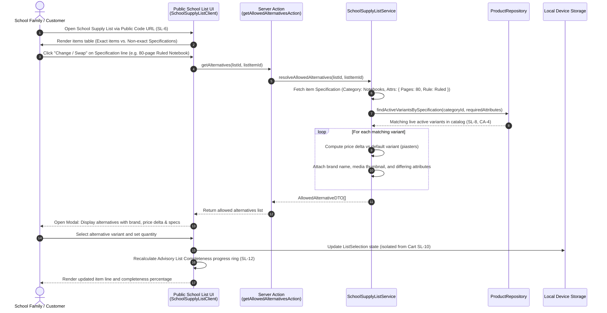
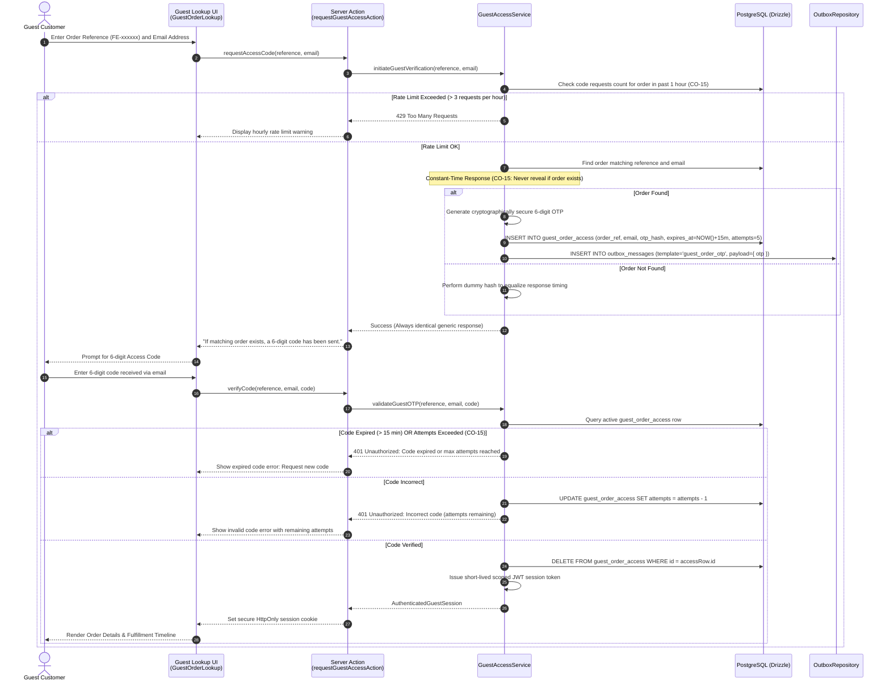
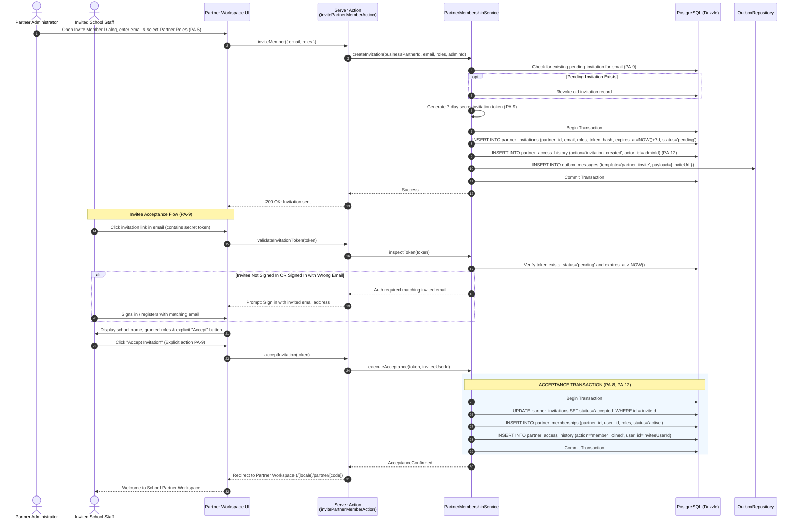
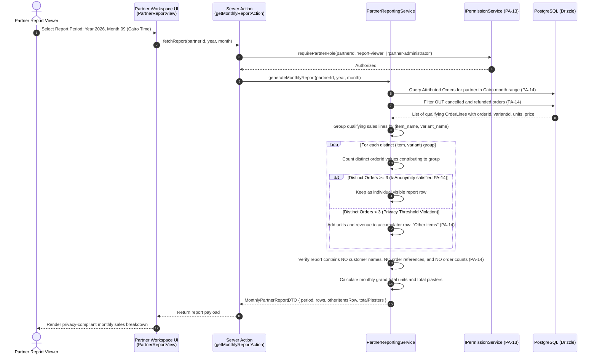

# Technical & Business Sequence Diagrams

As of 2026-10-12 · Clarity: **Enterprise Multi-Tier Interaction Specifications**

This document details the exact multi-tier runtime interaction flows across the FindEg system. Each sequence diagram models the end-to-end communication between the **Actor**, **UI Client Component**, **Next.js Server Action / API Route**, **Application Service Layer**, **Domain Ports & Invariants**, **PostgreSQL Database Transaction (Drizzle)**, **Transactional Outbox**, and **External Gateways**.

---

## 1. Catalog & Merchandising Ingestion

### SEQ-1: Catalog Bulk Spreadsheet Ingestion Pipeline

How catalog editors upload bulk spreadsheets, validate data integrity against business rules, and commit products atomically.

---

## 2. Quoting & Order Acceptance

### SEQ-2: Dynamic Quoting, Digest Fingerprinting & Reconfirmation

How the server provides authoritative pricing, generates cryptographic confirmation fingerprints, and forces reconfirmation if prices change.

---

### SEQ-3: Atomic Order Acceptance & Stock Hold (B2C & List Orders)

The all-or-nothing checkout transaction creating the immutable order, freezing lines, holding warehouse stock, and enqueuing notifications.

---

## 3. Operations & Fulfillment

### SEQ-4: COD Phone Confirmation, Dispatch & Cash Settlement Pipeline

The operational journey moving an order through phone verification, warehouse packing, courier delivery, and financial reconciliation.

---

## 4. School Partner Program

### SEQ-5: School Supply List Authoring, Freezing & Slot Replacement

How staff curates lists, freezes specifications on publish, and automatically supersedes existing versions in the same slot.

---

### SEQ-6: School Supply List Runtime Alternative Resolution & Selection

How families query allowed alternative products matching frozen specifications and build an isolated List Selection.

---

## 5. Security, Identity & Privacy

### SEQ-7: Passwordless Guest Order Access & Rate-Limited OTP

How guests view order tracking timelines without passwords while preventing account enumeration and brute-force attacks.

---

### SEQ-8: Partner Member Invitation & Tokenized Acceptance

How school staff join their school's Partner Workspace via 7-day tokenized invitations.

---

### SEQ-9: Privacy-Preserving Monthly Partner Reporting Pipeline

How aggregated monthly reports are generated with strict k-anonymity privacy guarantees.

