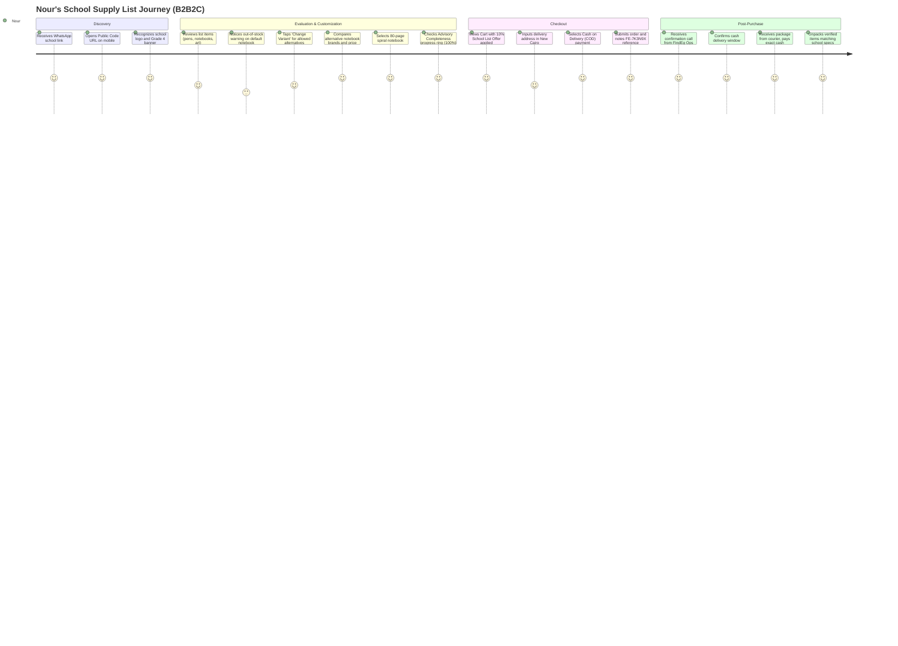
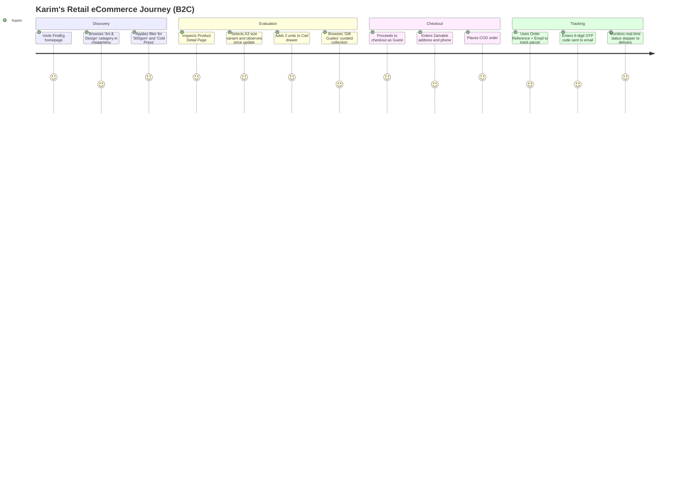

# UI/UX Requirements & User Journey Specifications

As of 2026-10-12 · Clarity: **Enterprise Experience Architecture & Design System Standards**

This document establishes the user experience requirements, persona journey maps, design system tokens, and screen-by-screen specifications across the three FindEg web surfaces:
1. **Storefront Application** (`@findeg/storefront`): B2C catalog shopping and public B2B2C School Supply Lists.
2. **Partner Workspace Application** (`/[locale]/partner/[code]`): School member management and anonymized sales reports.
3. **Operations Dashboard Application** (`@findeg/dashboard`): Staff catalog authoring, supply list publishing, and order fulfillment.

---

## 1. User Journey Maps

### Persona 1: Nour (School Parent)
- **Profile**: 36-year-old mother of two in New Cairo. Busy schedule, values time savings and accuracy in school preparations.
- **Scenario**: Received a WhatsApp link from her daughter's school for the Grade 4 Supply List. Wants to fulfill it in one go with reliable delivery.



| Journey Stage | Nour's Action | Touchpoint / Screen | Emotional State | Pain Points & Friction | UI/UX Opportunity |
|---|---|---|---|---|---|
| **1. Trigger & Discovery** | Taps link in school chat | Mobile Browser | Relieved, attentive | Worried list might be wrong version | Prominent School Badge, Academic Year, and Grade confirmation header |
| **2. Review & Customization** | Inspects lines, swaps notebook | School Supply List Page, Allowed Alternatives Modal | Focused, evaluating | Unclear if substitute is school-approved | Clear "Allowed by School" green checkmark & live price difference |
| **3. Completeness Check** | Verifies all required items | Advisory Completeness Ring | Confident | Fear of missing mandatory item | Circular animated progress indicator showing "12 of 12 required items selected" |
| **4. Checkout** | Enters address & phone | Checkout Flow | Reassured | Extra delivery fees or complex signups | Zero login required; explicit 50 EGP flat shipping; clear COD breakdown |
| **5. Delivery & Handoff** | Confirms by phone, pays courier | Phone call & Doorstep | Delighted | Courier lacking change | Clear SMS/Email stating exact piasters due upon delivery |

---

### Persona 2: Karim (General Stationery & Gift Shopper)
- **Profile**: 28-year-old architect and designer living in Zamalek, Cairo. Seeks premium sketchbooks, fine pens, and gifts for colleagues.
- **Scenario**: Searching for heavyweight watercolor paper and fountain pen ink on desktop.



---

### Persona 3: Mona (Partner School Principal & Administrator)
- **Profile**: 52-year-old school administrator managing a private British curriculum school in Giza.
- **Scenario**: Wants parents to get exact supply requirements without school staff handling inventory or physical sales.
- **Key Goals**: Invite the school bursar to view sales reports, ensure lists are published accurately, preserve family privacy.

---

### Persona 4: Tarek (School Bursar & Report Viewer)
- **Profile**: 44-year-old finance director. Needs monthly visibility over supplies purchased for budgeting future lab and classroom fees.
- **Scenario**: Logs into Partner Workspace at the end of September. Views aggregated unit counts per item without seeing individual family data.

---

### Persona 5: Youssef (FindEg Operations & Fulfillment Agent)
- **Profile**: 26-year-old operations specialist based in FindEg's Cairo fulfillment hub.
- **Scenario**: Monitors incoming COD orders, makes verification calls, prints waybills, handles courier returns.

---

### Persona 6: Salma (Catalog & Content Editor)
- **Profile**: 31-year-old merchandiser managing 1,500+ SKUs and 40 partner school lists.
- **Scenario**: Bulk imports supplier catalogs via spreadsheet, authors school supply lists, defines item specifications, and schedules home page promotional banners.

---

## 2. Design System Foundation

Built on top of `@findeg/ui`, Tailwind CSS, Radix UI, and shadcn primitives.

### 2.1. Bilingual Typography Strategy
The platform supports Arabic (`ar`) and English (`en`) seamlessly:
- **Arabic Script (`dir="rtl"`)**: Primary font is **Cairo** (`font-sans`), optimized for Arabic letterforms, diacritics, and reading flow.
- **English Script (`dir="ltr"`)**: Primary font is **Inter** / system sans-serif (`font-sans`), offering clean geometric legibility.
- **Monospace**: `JetBrains Mono` / system mono for Order References (`FE-xxxxxx`), SKUs, and OTP codes.

```css
/* Typography Scale */
--text-xs:   0.75rem / 1.00rem; /* Captions, micro-badges */
--text-sm:   0.875rem / 1.25rem; /* Form labels, table cells, secondary copy */
--text-base: 1.00rem / 1.50rem; /* Body copy, inputs, standard buttons */
--text-lg:   1.125rem / 1.75rem; /* Section subheadings, card titles */
--text-xl:   1.25rem / 1.75rem; /* Modal headers, prominent prices */
--text-2xl:  1.50rem / 2.00rem; /* Page titles, category headers */
--text-3xl:  1.875rem / 2.25rem; /* Hero banners */
```

### 2.2. Bi-Directional RTL Compliance Standards
Per platform architecture rules, all layouts MUST use **Tailwind Logical Properties**:
- ✅ `ps-4`, `pe-4` (Padding Inline Start / End) instead of `pl-4`, `pr-4`.
- ✅ `ms-2`, `me-2` (Margin Inline Start / End) instead of `ml-2`, `mr-2`.
- ✅ `border-s-2`, `border-e-2` (Border Inline Start / End) instead of `border-l-2`, `border-r-2`.
- ✅ `start-0`, `end-0` (Position Inline Start / End) instead of `left-0`, `right-0`.
- ✅ Icons with directional orientation (arrows, chevrons) MUST use `rtl:rotate-180`.

### 2.3. Color Palette & Semantic Tokens (HSL)
```css
:root {
  /* Brand Core */
  --primary: 221 83% 53%;         /* Royal Indigo #2563EB - Trust, Professionalism */
  --primary-foreground: 210 40% 98%;

  /* Growth / School Extension */
  --school: 142 76% 36%;          /* Emerald Green #15803D - Education, Go-Ahead (4.9:1 WCAG AA) */
  --school-foreground: 210 40% 98%;

  /* Base & Surfaces */
  --background: 0 0% 100%;        /* Clean White */
  --foreground: 222 47% 11%;      /* Deep Slate #0F172A */
  --card: 0 0% 100%;
  --card-foreground: 222 47% 11%;
  --popover: 0 0% 100%;
  --popover-foreground: 222 47% 11%;

  /* Interactive States */
  --muted: 210 40% 96%;           /* Light Gray #F1F5F9 */
  --muted-foreground: 215 16% 47%;/* Medium Gray #64748B */
  --accent: 210 40% 96%;
  --accent-foreground: 222 47% 11%;

  /* Feedback & Diagnostics */
  --destructive: 0 72% 51%;       /* Crimson #DC2626 (4.9:1 WCAG AA) */
  --destructive-foreground: 210 40% 98%;
  --warning: 38 92% 50%;          /* Amber #F59E0B */
  --success: 142 71% 45%;          /* Emerald #16A34A */

  /* Borders & Focus */
  --border: 214 32% 91%;          /* Slate Border #E2E8F0 */
  --input: 214 32% 91%;
  --ring: 221 83% 53%;            /* Accessible Focus Ring */
  --radius: 0.5rem;               /* 8px Standard Corner Radius */
}
```

---

## 3. Screen-by-Screen UI/UX Specifications

### 3.1. Storefront Application

#### Screen SF-1: Homepage & Navigation
- **Header**:
  - Top utility bar: Locale toggle (عربي / English), Contact phone hotline, Delivery promise ("Flat 50 EGP delivery across Egypt").
  - Main header: FindEg logo, search bar with category selector, School Partner Program link ("School Lists"), Cart trigger button with live item badge.
  - Category megamenu: 2-level hierarchical navigation with icons for major categories (Stationery, Notebooks, Art & Craft, Gifts & Toys).
- **Hero Banner Carousel**: Promotional slides highlighting seasonal stationery and featured school lists.
- **Curated Sections**: "Back to School Essentials", "Featured Gift Guides", "Top Rated by Families".

#### Screen SF-2: Product Listing Page (PLP) & Search Results
- **Sidebar Filters**:
  - Category tree accordion with single-select constraint.
  - Dynamic Tag Groups (e.g. "Age", "School Prep", "Paper Weight").
  - Price range slider with minimum/maximum inputs in EGP.
  - In-stock only toggle switch.
- **Product Card**:
  - Aspect ratio 1:1 image with hover zoom.
  - Bilingual product title, manufacturer brand pill.
  - Price display: Live price in EGP, optional strike-through price, discount percentage badge.
  - Rating stars with review count.
  - "Add to Cart" quick button (opens variant picker if multiple variants exist).

#### Screen SF-3: Product Detail Page (PDP)
- **Media Gallery**: High-resolution carousel with clickable thumbnails, zoom on hover, supplier photo attribution.
- **Variant Selector**:
  - Color swatches with active ring indicator.
  - Size/weight pills (e.g., "A4 - 80gsm", "A5 - 100gsm").
  - SKU indicator (e.g. `SKU: NB-OX-A4-80`).
- **Stock Status Indicator**:
  - Green pill: "In Stock (Ships in 24-48h)".
  - Amber pill: "Only 3 left in stock".
  - Gray pill: "Out of Stock".
- **Customer Reviews Section**: Average rating score (1-5), verified purchase badges, review submission form.

#### Screen SF-4: School Supply List Page (Public Link via Public Code)
- **School Header Banner**:
  - Partner School Logo, School Name, Verified School Badge.
  - Academic Year pill (e.g. `2026-2027`) and Grade pill (e.g. `Grade 4 / Year 5`).
  - Active List Offer promotional banner: "🎒 10% School Partner Discount applied to all items!".
- **Sticky Advisory Completeness Bar**:
  - Circular progress ring showing percentage covered.
  - Text: "12 of 12 required items selected".
  - "Checkout List Selection" CTA button (sticky on mobile).
- **Items Table**:
  - Column 1: Item requirement badge (`Required` in indigo vs. `Optional` in slate).
  - Column 2: Prescribed item description & specifications.
  - Column 3: Chosen Variant thumbnail, brand, and unit price in EGP.
  - Column 4: Prescribed quantity counter with `+` / `-` buttons.
  - Column 5: Action button:
    - If `Exact Item`: "Fixed (No Substitutes)" lock icon.
    - If `Specification`: "Change Variant" button opening the Alternatives Modal.

#### Screen SF-5: Allowed Alternatives Modal (Dynamic Substitution)
- **Modal Header**: "Choose an Alternative for [Item Specification]".
- **Current Selection Card**: Displays curated default variant with price and attributes.
- **Alternatives Comparison Grid**:
  - Lists all active catalog variants matching the frozen category and attributes.
  - Brand logo/name, paper weight, binding type.
  - Live price with comparative delta pill (e.g. `+15 EGP` or `-10 EGP`).
  - "Select this variant" radio button.
- **Footer**: "Confirm Swap" button updating device List Selection.

#### Screen SF-6: Checkout Page (Single-Page Responsive)
- **Step 1: Contact Information**: Name, Email (for order receipt & guest tracking), Egyptian mobile phone number.
- **Step 2: Delivery Address**: Governorate dropdown (all 27 Egyptian governorates), City, Street address, Building/Apartment notes.
- **Step 3: Payment Method**: Cash on Delivery (`cod`) pre-selected and locked (Card disabled with "Coming Soon" note).
- **Order Summary Card**:
  - Line items with quantities and piaster totals.
  - List Offer discount line (if list order).
  - Flat shipping fee line: "50.00 EGP".
  - Grand total in EGP.
- **Reconfirmation Dialog (Modal)**: Triggered if prices or offer change during checkout: "Prices have been updated. Your new total is [Total] EGP. Would you like to proceed?".

#### Screen SF-7: Order Confirmation & Guest Tracking
- **Confirmation Screen**:
  - Green checkmark animation with prominent **Order Reference**: `FE-7K3N9X`.
  - Notice: "Our team will phone you within 24 hours to confirm your Cash on Delivery order before dispatch."
- **Guest Tracking Screen**:
  - Step 1: Input Order Reference (`FE-xxxxxx`) and Email address.
  - Step 2: 6-digit OTP modal with 15-minute countdown timer and "Resend Code" trigger.
  - Step 3: Interactive Order Timeline Stepper:
    1. *Order Placed* (Pending)
    2. *Phone Confirmed* (Confirmed)
    3. *Preparing Parcel* (Processing)
    4. *Out for Delivery* (Shipped)
    5. *Delivered & Paid* (Delivered)

---

### 3.2. Partner Workspace Application (`/[locale]/partner/[code]`)

#### Screen PW-1: Workspace Shell & Header
- **School Branding**: School name, logo, Partner Code, and live Status badge (`Active` green, `Suspended` amber with banner).
- **Tabs Navigation**:
  - `Overview`: General school profile details.
  - `Members & Access`: Staff invitation and role management.
  - `Sales Reports`: Monthly anonymized volume reports.

#### Screen PW-2: Members & Access Management
- **Members Table**: Name, Email, Assigned Partner Roles (`partner-administrator`, `report-viewer`), Status (`Active`, `Suspended`), Last Active timestamp.
- **Invite Member Modal**:
  - Email input.
  - Multi-select role checkboxes.
  - Notice: "An invitation link valid for 7 days will be emailed."
- **Safety Invariant Alert**: Confirmation modal preventing actions that remove the last active Partner Administrator (**PA-7**).

#### Screen PW-3: Monthly Sales Report View
- **Period Filter**: Year and Month selector in Cairo local time.
- **Summary Metrics Cards**:
  - Total Items Purchased (Units).
  - Total School Lists Fulfilled.
  - School Partner Program Status.
- **Privacy-Preserving Data Table**:
  - Columns: List Item Name, Variant / Brand, Units Sold, Total Value (EGP).
  - **k-Anonymity Privacy Row**: Folded `"Other items"` row displaying aggregate units for any items purchased across fewer than 3 orders (**PA-14**).
  - Privacy Guarantee Badge: "Verified: Report contains zero customer names, contact info, or order references."

---

### 3.3. Operations Dashboard Application (`/dashboard`)

#### Screen DB-1: Staff Shell & Role Gate
- **Sidebar**: Role-gated navigation tabs:
  - *Catalog & Merchandising* (Editor, Admin)
  - *School Supply Lists* (Editor, Admin)
  - *Orders & Fulfillment* (Operations, Admin)
  - *Business Partners* (Admin)
  - *Audit Log* (Admin)

#### Screen DB-2: Catalog Management & Bulk Importer
- **Product Table**: Bilingual search, status filter (`Active` / `Inactive`), SKU search, price in EGP.
- **Bulk Spreadsheet Dropzone**: Drag-and-drop zone for `.xlsx`/`.csv` files with live validation progress bar and row-by-row error reporting modal.

#### Screen DB-3: School Supply List Editor
- **Slot Selector**: Partner School picker, Academic Year, Grade selector.
- **Item Builder**:
  - Add line button: Toggle between `Exact Item` and `Specification`.
  - Category selector & Attribute filter tags.
  - Default Variant selector with live stock warning badge.
- **Publish & Replace Stepper**:
  - Pre-publish checklist verification (SL-5).
  - Slot Replacement Alert: Warns if an existing list in the slot will be automatically superseded and archived (**SL-4**).

#### Screen DB-4: Order Operations & Fulfillment Queue
- **Pending Orders Queue**: Orders awaiting phone confirmation.
- **Customer Verification Action**:
  - Displays customer phone number with one-click call trigger.
  - "Mark Confirmed" button with agent note input (**CO-18**).
  - "Cancel Order" button with mandatory cancellation reason dropdown.
- **Fulfillment Stepper**: Action buttons to advance orders through `processing` $\rightarrow$ `shipped` $\rightarrow$ `delivered`.

#### Screen DB-5: Transactional Audit Log
- **Table**: Timestamp (Cairo time), Staff Member, Staff Role, Entity Type, Entity ID, Action (`order_confirmed`, `price_updated`), JSON Diff viewer modal (**ID-3**).

---

## 4. Cross-Cutting UX Specifications

### 4.1. Component State Specifications
Every interactive UI component MUST implement 7 distinct visual states:
1. **Default**: Clear contrast with resting elevation.
2. **Hover**: Subtle background tint or elevation lift (`transition-colors duration-150`).
3. **Active / Pressed**: Scaled feedback (`active:scale-[0.98]`).
4. **Focus-Visible**: High-contrast accessible focus ring (`focus-visible:ring-2 focus-visible:ring-primary focus-visible:ring-offset-2`).
5. **Disabled**: Opacity reduced to 50%, `cursor-not-allowed`, non-interactive.
6. **Loading**: Retains dimensions, displays spinning loader or animated Skeleton shimmer (`animate-pulse bg-muted`).
7. **Empty State**: Friendly illustration, descriptive title, explanation copy, and primary action button.

### 4.2. Form Validation & Error Messaging
- **Inline Validation**: Errors display immediately below the corresponding input field in crimson (`text-destructive text-sm`).
- **Bilingual Errors**: Error messages are localized in Arabic and English (e.g. "يرجى إدخال رقم هاتف مصري صحيح" / "Please enter a valid Egyptian phone number").
- **Preserved Input**: Invalid form submissions MUST NEVER wipe user-entered data.

### 4.3. Accessibility (WCAG 2.1 Level AA) Compliance
- **Color Contrast**: Text and interactive elements maintain a contrast ratio of at least `4.5:1` against their backgrounds (and `3:1` for large text).
- **Keyboard Navigation**: Full keyboard tab order across all forms, dialogs, drawers, and tables. Modals implement strict focus traps.
- **ARIA Live Regions**: Cart updates, quote recalculations, and advisory completeness changes use `aria-live="polite"` to notify screen readers.
- **Touch Targets**: All mobile interactive elements (buttons, variant swatches, quantity steppers) maintain a minimum hit area of `44px x 44px`.
