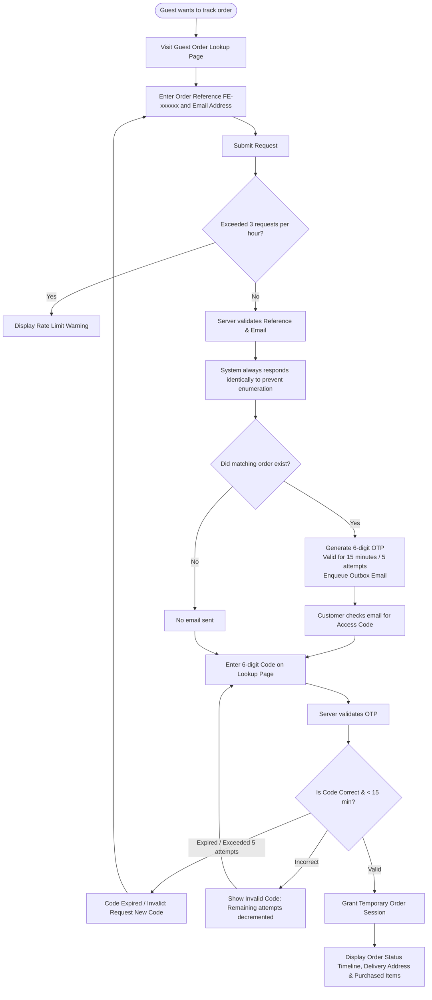
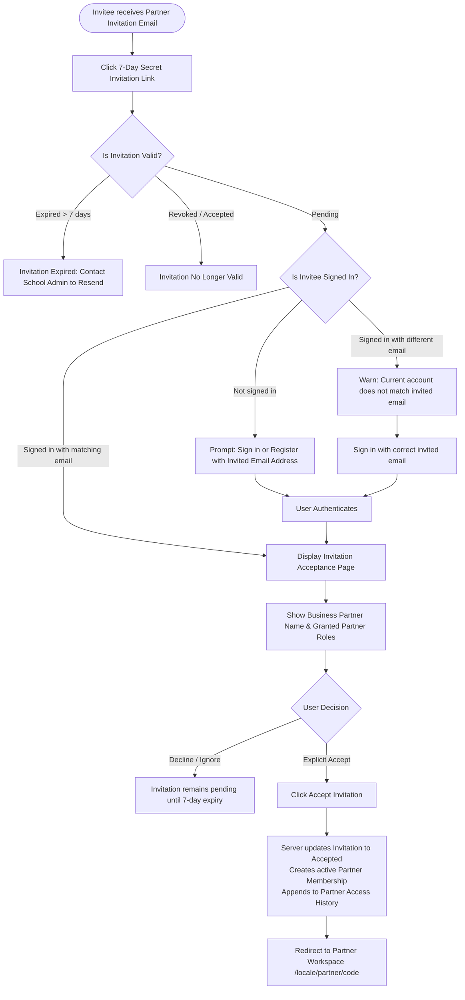
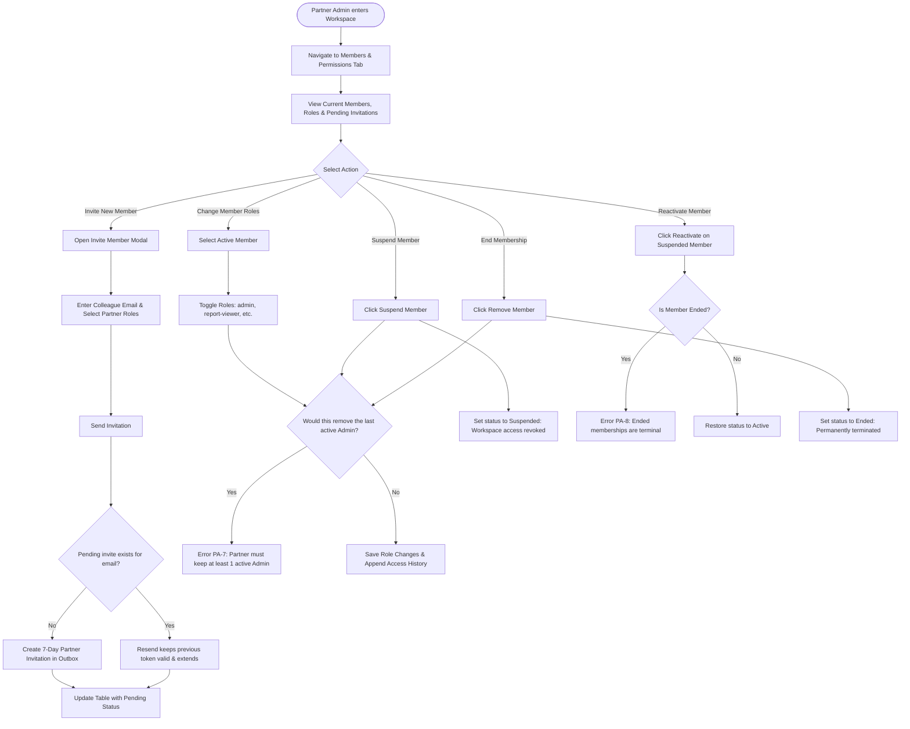
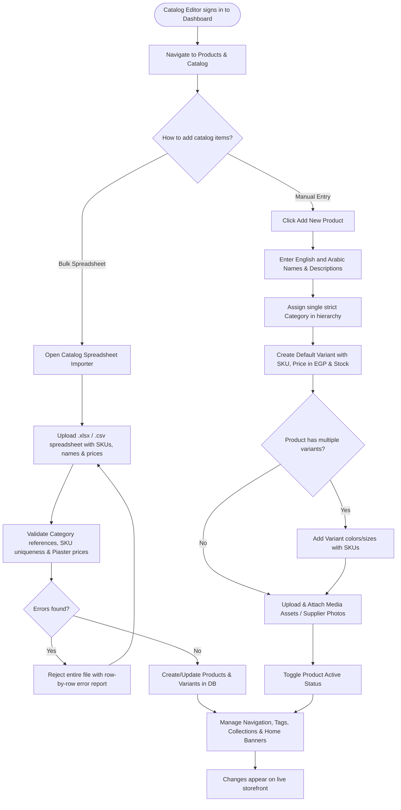
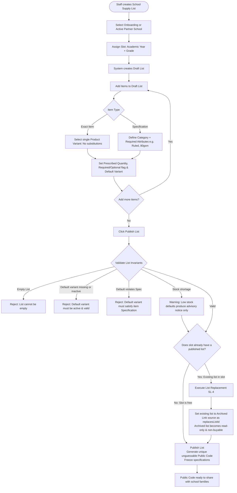
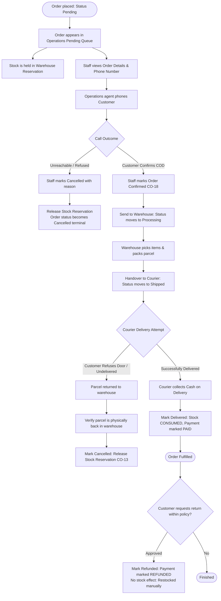

# Enterprise User Flow Diagrams

As of 2026-10-12 · Clarity: **Enterprise User Experience & Journey Specifications**

This document catalogs the complete end-to-end user flows for all human personas across the FindEg platform: Customers (Guests & Registered), Partner School Members, and FindEg Operations Staff.

---

## 1. Customer User Flows

### UF-1: B2C Storefront Shopping Journey (Catalog to Checkout)

The standard direct-to-consumer flow where a customer browses the catalog, builds a Cart, and places a Cash on Delivery (COD) order.

```mermaid
flowchart TD
    Start([Customer visits Storefront]) --> Browse[Browse Home Banners, Categories & Collections]
    Browse --> SearchChoice{How does Customer find items?}
    SearchChoice -->|Keyword Search| SearchResults[Search Results + Attribute & Tag Filters]
    SearchChoice -->|Category Tree| CategoryPage[Category Page]
    SearchChoice -->|Curated Collection| CollectionPage[Collection Page e.g. Gift Guides]

    SearchResults --> SelectProduct[Select Product]
    CategoryPage --> SelectProduct
    CollectionPage --> SelectProduct

    SelectProduct --> PDP[Product Detail Page]
    PDP --> ReviewVariant[Inspect Default Variant, Images, Price & Stock]
    ReviewVariant --> ChangeVariant{Wants another variant?}
    ChangeVariant -->|Yes| SelectVariant[Choose Color, Size or Weight]
    ChangeVariant -->|No| KeepVariant[Keep Default Variant]
    
    SelectVariant --> AddToCart[Add to Cart]
    KeepVariant --> AddToCart
    AddToCart --> ContinueShopping{Continue Shopping?}
    ContinueShopping -->|Yes| Browse
    ContinueShopping -->|No| OpenCart[Open Cart Drawer / Page]

    OpenCart --> ReviewCart[Review Items, Quantities & Piaster Total]
    ReviewCart --> ProceedCheckout[Proceed to Checkout]

    ProceedCheckout --> AuthChoice{Customer Authentication}
    AuthChoice -->|Signed-in| LoadAddresses[Pre-fill Saved Delivery Address]
    AuthChoice -->|Guest| EnterGuestDetails[Enter Name, Email, Phone & Delivery Address]

    LoadAddresses --> ReviewShipping[Review Flat Shipping Fee: 50 EGP]
    EnterGuestDetails --> ReviewShipping

    ReviewShipping --> PaymentMethod[Select Payment Method: Cash on Delivery]
    PaymentMethod --> RequestQuote[Fetch Server Authoritative Quote]
    RequestQuote --> QuoteVerification{Quote Digest Matches Confirmation?}
    QuoteVerification -->|Price / Stock Changed| ReconfirmAlert[Display Price/Shipping Change Alert & Reconfirm]
    ReconfirmAlert --> RequestQuote
    QuoteVerification -->|Matches| PlaceOrder[Click Place Order]

    PlaceOrder --> AtomicAcceptance[Server Executes Atomic Order Acceptance]
    AtomicAcceptance --> StockCheck{Stock Available at Warehouse?}
    StockCheck -->|No| OrderRejected[Show Stock Shortage Error: Entire Order Rejected]
    StockCheck -->|Yes| OrderCreated[Order Created with Reference FE-xxxxxx<br/>Stock Reserved<br/>Outbox Email Enqueued]
    OrderCreated --> ThankYouPage[View Order Confirmation Page with Order Reference]
```



---

### UF-2: School Supply List Family Journey (B2B2C Partner Service)

The journey of a family fulfilling their child's school requirements through a single published list.

```mermaid
flowchart TD
    Start([Family receives School Supply List Link]) --> OpenLink[Open Public Link via Public Code]
    OpenLink --> ValidateList{Is List Valid?}
    ValidateList -->|Draft / Not Found| ErrorPage[404 Not Found: Drafts never public]
    ValidateList -->|Archived| ArchivedNotice[Show Archived Banner & Link to Replacement List]
    ArchivedNotice --> OpenReplacement[Navigate to Active Replacement List]
    ValidateList -->|Published| RenderList[Render Published School Supply List]

    OpenReplacement --> RenderList
    RenderList --> DisplayHeader[Display Partner School Name, Grade, Academic Year & List Offer %]
    DisplayHeader --> IterateItems[Review Curated List Items]

    IterateItems --> ItemType{Item Line Type}
    ItemType -->|Exact Item| ExactLine[Fixed Product Variant: No Substitution Allowed]
    ItemType -->|Specification| SpecLine[Item Specification: Category + Attributes Defined]

    ExactLine --> QuantityChoice{Adjust Prescribed Quantity?}
    SpecLine --> AlternativeChoice{Choose Alternative Variant?}

    AlternativeChoice -->|Keep Default| KeepDefault[Retain Curated Default Variant]
    AlternativeChoice -->|Browse Alternatives| ModalOpen[Open Allowed Alternatives Modal]

    ModalOpen --> QueryAlternatives[Engine computes matching live variants]
    QueryAlternatives --> ReviewAltList[Compare Brand, Specs & Price Deltas]
    ReviewAltList --> SelectAlternative[Select Preferred Variant]
    SelectAlternative --> UpdateLine[Update Line with Chosen Variant]

    KeepDefault --> QuantityChoice
    UpdateLine --> QuantityChoice

    QuantityChoice --> SetQty[Set Item Quantity in List Selection]
    SetQty --> CompletenessCheck[Evaluate Advisory List Completeness Indicator]
    CompletenessCheck --> AddMoreItems{Review remaining items?}
    AddMoreItems -->|Yes| IterateItems
    AddMoreItems -->|No| ReviewSelection[Review List Selection Summary & List Offer Discount]

    ReviewSelection --> ProceedListCheckout[Proceed to List Checkout]
    ProceedListCheckout --> VerifyEligibility{All selected variants active & allowed?}
    VerifyEligibility -->|No: Inactive Variant| ExactCheck{Is line an Exact Item?}
    ExactCheck -->|Yes: Exact Item (SL-8 No Substitutes)| BlockedItem[Flag item as Unavailable: Requires Staff List Replacement or Removal]
    ExactCheck -->|No: Has Specification| FlaggedLine[Flag line as 'Choose Again': Checkout Disabled]
    FlaggedLine --> AlternativeChoice
    VerifyEligibility -->|Yes| CheckoutScreen[Enter Delivery Address & Contact Phone]

    CheckoutScreen --> ListQuote[Server calculates Quote with List Offer % discount]
    ListQuote --> SubmitListOrder[Confirm Cash on Delivery Order]
    SubmitListOrder --> AtomicListAcceptance[Atomic Acceptance: Freeze Attribution + AttributedOrder + Reserve Stock]
    AtomicListAcceptance --> ConfirmationScreen[Order Confirmation with FE-xxxxxx & Attributed School]
```

---

### UF-3: Guest Order Tracking Flow (Passwordless Access)

How a customer without an account securely verifies and inspects their order status.



---

## 2. Partner User Flows

### UF-4: Partner Member Onboarding Flow

How school administrators and bursars join their school's Partner Workspace.



---

### UF-5: Partner Administrator Governance Flow

How a partner administrator manages memberships and invitations for their school.



---

### UF-6: Partner Report Viewer Flow (Privacy-Preserving Analytics)

How school leaders view aggregate sales generated by their supply lists.

```mermaid
flowchart TD
    Start([Report Viewer enters Workspace]) --> NavReports[Navigate to Sales Reports Tab]
    NavReports --> PermCheck{Has report-viewer or admin role?}
    PermCheck -->|No| Denied[Access Denied]
    PermCheck -->|Yes| SelectPeriod[Select Year & Month (Cairo Time)]

    SelectPeriod --> FetchReport[Query Attributed Orders for School]
    FetchReport --> FilterOrders[Exclude Cancelled & Refunded Orders]
    FilterOrders --> GroupByItem[Group Sales by List Item and Variant]

    GroupByItem --> EvaluateKAnonymity{Does line have >= 3 distinct Orders?}
    EvaluateKAnonymity -->|Yes| DisplayLine[Display Item Name, Variant & Monthly Units Sold]
    EvaluateKAnonymity -->|No: < 3 Orders| FoldLine[Fold into 'Other Items' Aggregate Row]

    DisplayLine --> RenderTable[Render Monthly Partner Report]
    FoldLine --> RenderTable
    RenderTable --> PrivacyAssurance[Verify: No Customer Names, No Order References, No Order Counts Shown]
```

---

## 3. FindEg Staff User Flows

### UF-7: Staff Catalog & Merchandising Flow

How internal staff curate and maintain the stationery store.



---

### UF-8: Staff School Supply List Authoring & Versioning Flow

How staff create, validate, publish, and replace supply lists.



---

### UF-9: Staff Operations & Order Fulfillment Flow

The fulfillment journey from phone verification to cash collection.


